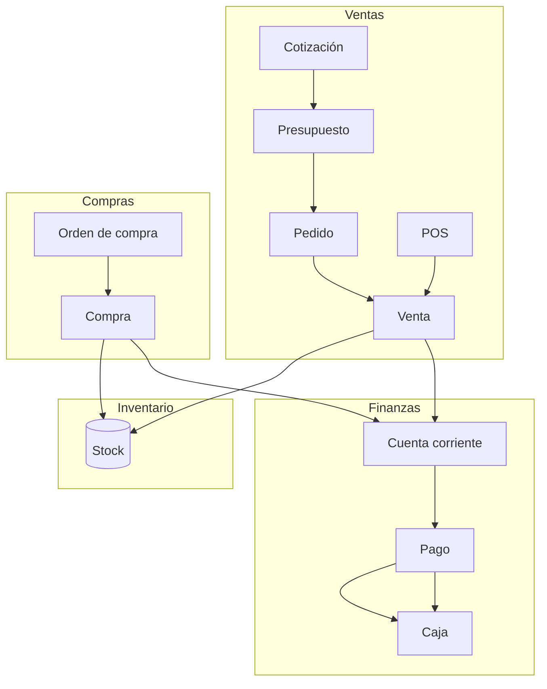

## Resumen

ZinK ERP organiza el negocio en un sistema conectado donde cada operación impacta automáticamente en otras áreas.

Permite gestionar:

- ventas
- compras
- stock
- dinero

todo de forma integrada y en tiempo real.

---

## Cómo está organizado el sistema

ZinK ERP se estructura en módulos que representan procesos reales del negocio.

Estos módulos no funcionan de forma aislada, sino conectados entre sí.

---

## Flujo del negocio

El sistema refleja el funcionamiento real de cualquier empresa:

### Ventas

[Cotización → Presupuesto → Pedido → Venta](./ventas/flujo-ventas.md), o [POS](./ventas/pos.md) para venta directa.

### Compras

[Orden de compra → Compra](./compras/flujo-compras.md)

### Inventario

Compras y ventas mueven stock; los [ajustes](./inventario/inventarios.md) corrigen sin documento comercial.

### Finanzas

[Venta / Compra → Cuenta corriente → Pago → Caja](./finanzas/finanzas.md)

---

## Qué significa esto en la práctica

Cada acción que realizás genera impacto automático:

- una **venta** descuenta stock
- una **compra** ingresa stock
- un **pago** reduce deuda
- un **egreso** reduce caja

👉 Todo está conectado.

---

## Estructura organizacional

ZinK ERP es un sistema **multiorganización**. Si operás con varias sucursales, ver [Múltiples sucursales](./administracion/multi-sucursal.md).

Cada organización representa:

- una sucursal
- un punto de venta
- una franquicia

Cada una tiene:

- sus operaciones
- su stock
- sus usuarios

---

## Usuarios y permisos

Los usuarios acceden al sistema con perfiles que definen:

- qué pueden ver
- qué pueden hacer

Esto permite controlar el acceso según el rol.

---

## Componentes principales

### Administración

Gestión de usuarios, contactos y estructura del sistema.

---

### Configuración

Define cómo funciona el sistema:

- datos de la organización
- preferencias
- integraciones

---

### Operaciones

Dónde ocurre el negocio:

- ventas
- compras
- inventario
- finanzas

---

### Informes

Permiten analizar:

- ventas
- stock
- dinero
- rendimiento

---

## Conceptos clave

### Todo está conectado

No existen módulos aislados.

Cada acción impacta en múltiples áreas.

---

### El orden importa

Trabajar correctamente el flujo evita errores:

- vender antes de cobrar
- comprar antes de pagar
- controlar stock antes de vender

---

### El sistema refleja la realidad

ZinK ERP no inventa procesos:

👉 replica cómo funciona un negocio real

---

## Casos frecuentes

### Venta simple

POS → Venta → Caja

---

### Venta con proceso

Cotización → Presupuesto → Pedido → Venta → Pago

---

### Compra de mercadería

Orden → Compra → Inventario → Pago

---

## Recomendaciones de uso

Para aprovechar el sistema:

- seguí los flujos definidos
- evitá saltear etapas innecesariamente
- controlá stock y caja diariamente

---

## Ver también

- [Flujo de ventas](./ventas/flujo-ventas.md)
- [Compras](./compras/compras.md)
- [Inventario](./inventario/inventarios.md)
- [Finanzas](./finanzas/finanzas.md)
