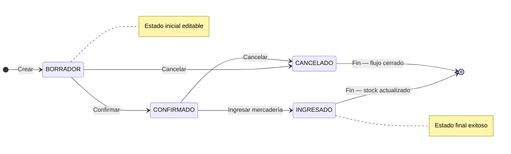

## Resumen

Las compras representan la instancia final del proceso de abastecimiento en Zink ERP.

Es donde se registra la operación con el proveedor, se ingresa la mercadería al stock y se impacta la cuenta corriente.

Puede generarse a partir de una orden de compra o registrarse directamente.

---

## Antes de empezar

- Tener proveedores cargados como contactos.
- Verificá que los productos estén configurados.
- Algunas modificaciones pueden requerir permisos especiales.
- Para registrar pagos a proveedores, el usuario debe tener permiso para **registrar pagos**.
- Revisá los **días de vencimiento de pago** del proveedor o la configuración general, porque pueden afectar cuándo queda pendiente la deuda.

---

## Ubicación dentro del flujo

Orden de compra → Compra

La compra es la etapa final del proceso.

- Puede generarse desde una orden de compra
- También puede registrarse directamente

---

## Qué cambia y qué no cambia

**La compra:**

- ✔️ Ingresa stock
- ✔️ Impacta cuenta corriente
- ✔️ Registra la operación con el proveedor
- ❌ No es editable una vez confirmada (según estado)

---

## Procedimiento

1. Crear una nueva compra (o generarla desde una orden).
2. Seleccionar el proveedor.
3. Agregar productos y cantidades.
4. Verificar precios y condiciones.
5. Confirmar la compra.
6. Si corresponde, registrar el pago al proveedor.
7. Registrar el ingreso de mercadería:
   - se actualiza el stock
8. Verificar impacto en cuenta corriente.

---

## Pago de la compra

Al aprobar o confirmar una compra, el sistema puede ofrecer registrar el pago al proveedor si:

- la compra tiene importe pendiente;
- el usuario tiene permiso para registrar pagos;
- el comprobante permite asociar el pago.

Si no se registra el pago en el momento, la deuda queda en la cuenta corriente del proveedor y puede pagarse luego desde Finanzas, Pagos o Cuenta corriente proveedores.

| Situación | Qué revisar |
|-----------|-------------|
| Se pagó en el momento | El pago debe aparecer en pagos, cuenta corriente del proveedor y caja diaria según fecha y medio. |
| Quedó pendiente | Revisá cuenta corriente proveedores. |
| No aparece el formulario de pago | Revisá permiso para registrar pagos y estado de la compra. |

---

## Estados

| Estado     | Descripción |
|------------|------------|
| BORRADOR   | Editable. |
| CONFIRMADO | No editable. |
| INGRESADO  | Se actualiza el stock. |
| CANCELADO  | Flujo cerrado. |

### Ciclo de vida

**Estado inicial:** BORRADOR · **Estado final (éxito):** INGRESADO · **Cierre sin éxito:** CANCELADO.

No aplica **Rechazar** como en ventas.

---

## Casos frecuentes

### Compra desde orden

Se genera la compra a partir de una orden previamente registrada.

### Compra directa

Se registra la compra sin planificación previa.

### Recepción de mercadería

Se confirma la llegada de productos y se actualiza el stock.

### Compra con deuda al proveedor

Se confirma la compra, pero el pago queda pendiente para cancelarlo luego.

Este caso impacta la cuenta corriente del proveedor.

---

## Recomendaciones de uso

Las compras deben utilizarse cuando la operación con el proveedor ya está definida y la mercadería está lista para ser ingresada.

Es ideal en situaciones como:

- Recepción de productos
- Compras confirmadas
- Ingreso de stock

👉 Evitá registrar compras si todavía estás planificando (usar órdenes de compra).

---

## Si algo sale mal

- **Stock incorrecto**
  - Verificá cantidades antes de confirmar.
  - Revisá si la compra ya fue ingresada.

- **Diferencias con proveedor**
  - Revisá valores registrados.
  - Verificá descuentos, impuestos y vencimiento de pago.

- **No podés modificar**
  - Puede estar en estado CONFIRMADO o INGRESADO.

- **No podés registrar el pago**
  - Revisá el permiso para registrar pagos.
  - Confirmá que la compra tenga importe pendiente.
  - Verificá que el proveedor esté correctamente seleccionado.

- **El pago no aparece en caja diaria**
  - Revisá la fecha del pago.
  - Confirmá el medio de pago.
  - Si la caja está filtrada por usuario, revisá el operador correcto.

---

## Buenas prácticas

- Verificá la mercadería antes de ingresarla.
- Controlá precios y cantidades.
- Usá órdenes de compra para planificar.
- Registrá correctamente el proveedor.

---

## Ver también

- [Órdenes de compra](./orden-compras.md)
- [Flujo de compras](./flujo-compras.md)
- [Pagos](../finanzas/pagos.md)
- [Cuenta corriente](../finanzas/cuenta-corriente.md)
- [Caja diaria](../finanzas/caja-diaria.md)
