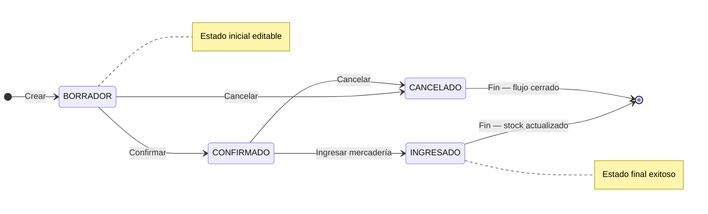

## Resumen

Las compras representan la instancia final del proceso de abastecimiento en ZinK ERP.

Es donde se registra la operación con el proveedor, se ingresa la mercadería al stock y se impacta la cuenta corriente.

Puede generarse a partir de una orden de compra o registrarse directamente.

---

## Cuándo usar compras

Usá esta pantalla cuando:

- la operación con el proveedor ya está definida;
- querés registrar la compra y su impacto económico;
- necesitás ingresar mercadería al stock;
- querés dejar deuda o pago asociado al proveedor.

---

## Antes de empezar

- Tener proveedores cargados como contactos.
- Verificá que los productos estén configurados.
- Algunas modificaciones pueden requerir permisos especiales.
- Para registrar pagos a proveedores, el usuario debe tener permiso para **registrar pagos**.
- Revisá los **días de vencimiento de pago** del proveedor o la configuración general, porque pueden afectar cuándo queda pendiente la deuda.

---

## Ubicación dentro del flujo

Orden de compra → Compra

La compra es la etapa final del proceso.

- Puede generarse desde una orden de compra
- También puede registrarse directamente

---

## Qué cambia y qué no cambia

**La compra:**

- ✔️ Ingresa stock
- ✔️ Impacta cuenta corriente
- ✔️ Registra la operación con el proveedor
- ❌ No es editable una vez confirmada (según estado)

---

## Procedimiento

### Paso 1: Crear la compra

1. Creá una nueva compra o generala desde una orden.
2. Seleccioná el proveedor correcto.

### Paso 2: Cargar productos y condiciones

3. Agregá productos, cantidades y precios.
4. Revisá vencimientos, descuentos o condición de pago si aplica.

### Paso 3: Confirmar la operación

5. Confirmá la compra.
6. Si corresponde, registrá el pago al proveedor.

### Paso 4: Ingresar mercadería

7. Registrá el ingreso de mercadería.
8. Verificá stock y cuenta corriente después del ingreso.

---

## Pago de la compra

Al aprobar o confirmar una compra, el sistema puede ofrecer registrar el pago al proveedor si:

- la compra tiene importe pendiente;
- el usuario tiene permiso para registrar pagos;
- el comprobante permite asociar el pago.

Si no se registra el pago en el momento, la deuda queda en la cuenta corriente del proveedor y puede pagarse luego desde Finanzas, Pagos o Cuenta corriente proveedores.

| Situación | Qué revisar |
|-----------|-------------|
| Se pagó en el momento | El pago debe aparecer en pagos, cuenta corriente del proveedor y caja diaria según fecha y medio. |
| Quedó pendiente | Revisá cuenta corriente proveedores. |
| No aparece el formulario de pago | Revisá permiso para registrar pagos y estado de la compra. |

### Cuándo pagar en el momento y cuándo dejar pendiente

- **Pago inmediato**: compras de contado o contra entrega.
- **Pago pendiente**: proveedores con cuenta corriente, fecha de vencimiento o cancelación posterior.

---

## Estados

| Estado     | Descripción |
|------------|------------|
| BORRADOR   | Editable. |
| CONFIRMADO | No editable. |
| INGRESADO  | Se actualiza el stock. |
| CANCELADO  | Flujo cerrado. |

Estos estados coinciden con el flujo de compras documentado. La recepción parcial puede requerir validación operativa adicional antes de marcar la compra como **INGRESADO**.

Ver [Recepción de mercadería](./recepcion-mercaderia.md) para controlar ingresos completos o parciales.

### Ciclo de vida

**Estado inicial:** BORRADOR · **Estado final (éxito):** INGRESADO · **Cierre sin éxito:** CANCELADO.

No aplica **Rechazar** como en ventas.

---

## Casos frecuentes

### Compra desde orden

Se genera la compra a partir de una orden previamente registrada.

### Compra directa

Se registra la compra sin planificación previa.

### Recepción de mercadería

Se confirma la llegada de productos y se actualiza el stock.

### Compra con deuda al proveedor

Se confirma la compra, pero el pago queda pendiente para cancelarlo luego.

Este caso impacta la cuenta corriente del proveedor.

### Compra con ingreso parcial

Si no recibís todo, no cierres el circuito sin documentar la diferencia. Revisá [Recepción de mercadería](./recepcion-mercaderia.md).

---

## Recomendaciones de uso

Las compras deben utilizarse cuando la operación con el proveedor ya está definida y la mercadería está lista para ser ingresada.

Es ideal en situaciones como:

- Recepción de productos
- Compras confirmadas
- Ingreso de stock

👉 Evitá registrar compras si todavía estás planificando (usar órdenes de compra).

---

## Si algo sale mal

- **Stock incorrecto**
  - Verificá cantidades antes de confirmar.
  - Revisá si la compra ya fue ingresada.

- **Diferencias con proveedor**
  - Revisá valores registrados.
  - Verificá descuentos, impuestos y vencimiento de pago.

- **No podés modificar**
  - Puede estar en estado CONFIRMADO o INGRESADO.

- **No podés registrar el pago**
  - Revisá el permiso para registrar pagos.
  - Confirmá que la compra tenga importe pendiente.
  - Verificá que el proveedor esté correctamente seleccionado.

- **El pago no aparece en caja diaria**
  - Revisá la fecha del pago.
  - Confirmá el medio de pago.
  - Si la caja está filtrada por usuario, revisá el operador correcto.

---

## Buenas prácticas

- Verificá la mercadería antes de ingresarla.
- Controlá precios y cantidades.
- Usá órdenes de compra para planificar.
- Registrá correctamente el proveedor.

---

## Preguntas frecuentes

### ¿Puedo comprar sin orden de compra?

Sí. La orden sirve para planificar, pero la compra puede cargarse directamente.

### ¿Cuándo impacta el stock?

Según el flujo documentado, al registrar la compra como **INGRESADO**.

### ¿Qué hago si recibí menos mercadería?

Documentá la diferencia antes de cerrar el circuito y revisá el criterio operativo con [Recepción de mercadería](./recepcion-mercaderia.md).

---

## Ver también

- [Órdenes de compra](./orden-compras.md)
- [Flujo de compras](./flujo-compras.md)
- [Recepción de mercadería](./recepcion-mercaderia.md)
- [Notas de crédito de compras](./notas-credito-compras.md)
- [Pagos](../finanzas/pagos.md)
- [Cuenta corriente](../finanzas/cuenta-corriente.md)
- [Caja diaria](../finanzas/caja-diaria.md)
