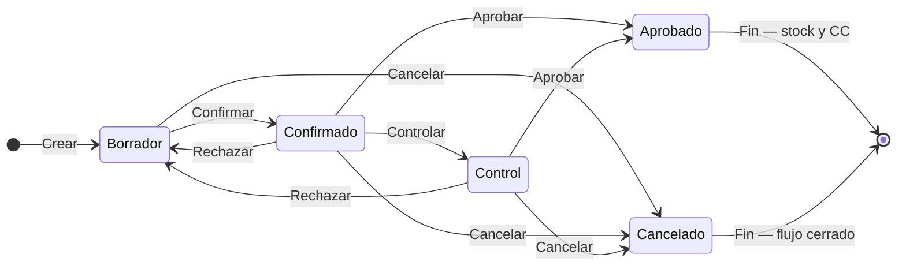

## Resumen

Las compras representan la instancia final del proceso de abastecimiento en Zink ERP.

Es donde se registra la operación con el proveedor, se ingresa la mercadería al stock y se impacta la cuenta corriente.

Puede generarse a partir de una orden de compra o registrarse directamente.

---

## Cuándo usar compras

Usá esta pantalla cuando:

- la operación con el proveedor ya está definida;
- querés registrar la compra y su impacto económico;
- necesitás ingresar mercadería al stock;
- querés dejar deuda o pago asociado al proveedor.

---

## Antes de empezar

- Tener proveedores cargados como contactos.
- Verificá que los productos estén configurados.
- Algunas modificaciones pueden requerir permisos especiales.
- Para registrar pagos a proveedores, el usuario debe tener permiso para **registrar pagos**.
- Revisá los **días de vencimiento de pago** del proveedor o la configuración general, porque pueden afectar cuándo queda pendiente la deuda.

---

## Ubicación dentro del flujo

Orden de compra → Compra

La compra es la etapa final del proceso.

- Puede generarse desde una orden de compra
- También puede registrarse directamente

---

## Qué cambia y qué no cambia

**La compra:**

- ✔️ Ingresa stock (al **Aprobar**)
- ✔️ Impacta cuenta corriente (al **Aprobar**)
- ✔️ Registra la operación con el proveedor
- ❌ No es editable una vez avanzada (según estado)

---

## Procedimiento

### Paso 1: Crear la compra

1. Creá una nueva compra o generala al **Aprobar** una [orden de compra](./orden-compras.md).
2. Seleccioná el proveedor correcto.
3. Completá **Tipo Comprobante**, **Fecha Compra**, **Fecha Entrega**, **Días Vencimiento Pago** y el número de **Comprobante** si aplica. Si viene de una OC, verás el chip **Orden de Compra asociada: …**.

### Paso 2: Cargar productos y condiciones

4. Agregá productos, cantidades, descuentos e impuestos (ver [Formulario de documentos](../guias/formulario-documento-v2.md)).
5. Por cada ítem, indicá si querés **Actualiza Costo** del producto (hay switch **Todos** para marcar todos). Ver sección siguiente.
6. Revisá vencimientos u observación si aplica.
7. Guardá con **Guardar (F2)** o **Guardar y Nuevo**. Atajos **/** y **\*** (precio/cantidad del ítem anterior) funcionan si la preferencia de accesos rápidos está activa.

### Paso 3: Confirmar y avanzar estados

8. En el listado: **Confirmar** → (opcional) **Controlar** → **Aprobar**.
9. Al **Aprobar**, impactan stock y cuenta corriente; si corresponde, registrá el pago al proveedor.

### Paso 4: Controlar recepción

10. Si la mercadería llega con diferencias, usá [Recepción de mercadería](./recepcion-mercaderia.md) y el estado **Control** antes de aprobar cuando corresponda.
11. Verificá stock y cuenta corriente después de **Aprobar**.

---

## Actualizar costo desde la compra

Al cargar ítems podés marcar, **producto por producto**, **Actualiza Costo** para que la compra actualice el costo del catálogo.

| En el ítem | En el producto | Resultado |
|------------|----------------|-----------|
| **Actualiza Costo** sí | Interruptor **Recalcular precios al modificar el costo** **ON** | Se actualiza el costo y se recalculan las listas **automáticas**. |
| **Actualiza Costo** sí | Interruptor **OFF** (o listas en precio manual) | Se actualiza el costo; los precios de venta **no** se recalculan solos. |
| **Actualiza Costo** no | — | El costo y los precios del producto quedan como estaban. |

El interruptor del producto y su valor por defecto al crear se explican en [Productos](../administracion/productos.md#costo-y-recalculo-de-precios) y [Preferencias](../configuracion/preferencias.md#actualizar-listas-de-precio-al-actualizar-costo).

Ejemplo: comprás un artículo a **AR$ 8.000** y marcás **Actualiza Costo**. Si el producto tiene recálculo activo y la lista minorista es automática con margen, el precio de venta se recalcula solo. Si la lista es de **precio manual**, ese precio no cambia hasta que lo edites vos.

Si el producto tiene costo en **USD** (con **Costo multi-moneda**), el costo en pesos sigue dependiendo de la [cotización](../configuracion/preferencias.md#cotizacion-de-moneda); la compra actualiza el costo según lo que indiques en el ítem y las reglas del producto.

---

## Pago de la compra

Al **aprobar** una compra, el sistema puede ofrecer registrar el pago al proveedor si:

- la compra tiene importe pendiente;
- el usuario tiene permiso para registrar pagos;
- el comprobante permite asociar el pago.

Si no se registra el pago en el momento, la deuda queda en la cuenta corriente del proveedor y puede pagarse luego desde Finanzas, Pagos o Cuenta corriente proveedores.

| Situación | Qué revisar |
|-----------|-------------|
| Se pagó en el momento | El pago debe aparecer en pagos, cuenta corriente del proveedor y caja diaria según fecha y medio. |
| Quedó pendiente | Revisá cuenta corriente proveedores. |
| No aparece el formulario de pago | Revisá permiso para registrar pagos y estado de la compra. |

### Cuándo pagar en el momento y cuándo dejar pendiente

- **Pago inmediato**: compras de contado o contra entrega.
- **Pago pendiente**: proveedores con cuenta corriente, fecha de vencimiento o cancelación posterior.

---

## Estados

| Estado | Descripción |
|--------|-------------|
| **Borrador** | Editable. |
| **Confirmado** | Compra confirmada; aún no impactó stock. |
| **Control** | Etapa de control operativo (útil ante recepción parcial o revisión). |
| **Aprobado** | Estado final exitoso: actualiza **stock** y puede impactar **cuenta corriente**. |
| **Cancelado** | Flujo cerrado. |

### Acciones del listado

| Acción | Efecto |
|--------|--------|
| **Confirmar** | Borrador → Confirmado. |
| **Controlar** | Pasa a **Control** (revisión antes de aprobar). |
| **Aprobar** | Impacta stock y cuenta corriente. |
| **Rechazar** | Vuelve el documento a un estado editable según el circuito. |
| **Cancelar** | Cierra en Cancelado. |

Ver [Recepción de mercadería](./recepcion-mercaderia.md) para diferencias entre lo comprado y lo recibido.

### Ciclo de vida

**Estado inicial:** Borrador · **Estado final (éxito):** Aprobado · **Cierre sin éxito:** Cancelado.

---

## Casos frecuentes

### Compra desde orden

Se genera la compra a partir de una orden previamente registrada.

### Compra directa

Se registra la compra sin planificación previa.

### Recepción de mercadería

Se confirma la llegada de productos y se actualiza el stock.

### Compra con deuda al proveedor

Se confirma la compra, pero el pago queda pendiente para cancelarlo luego.

Este caso impacta la cuenta corriente del proveedor.

### Compra con ingreso parcial

Si no recibís todo, no cierres el circuito sin documentar la diferencia. Revisá [Recepción de mercadería](./recepcion-mercaderia.md).

### Compra que actualiza costo y precios

Marcás actualizar costo en los ítems que cambiaron de precio de proveedor. Los productos con **Recalcular precios al modificar el costo** activo ajustan solos las listas automáticas; los de precio manual los revisás aparte.

### Compra que solo ingresa mercadería

Dejás sin marcar actualizar costo cuando el precio de compra es puntual, hay error de carga o no querés tocar el catálogo todavía.

---

## Recomendaciones de uso

Las compras deben utilizarse cuando la operación con el proveedor ya está definida y la mercadería está lista para ser ingresada.

Es ideal en situaciones como:

- Recepción de productos
- Compras confirmadas
- Ingreso de stock

👉 Evitá registrar compras si todavía estás planificando (usar órdenes de compra).

---

## Compartir

- **Compartir**: desde el detalle podés copiar un resumen, mandarlo por WhatsApp o email, o descargar el PDF. Ver [Compartir y enviar documentos](../guias/compartir-y-enviar-documentos.md).

---

## Si algo sale mal

- **Stock incorrecto**
  - Verificá cantidades antes de confirmar.
  - Revisá si la compra ya fue ingresada.

- **Diferencias con proveedor**
  - Revisá valores registrados.
  - Verificá descuentos, impuestos y vencimiento de pago.

- **No podés modificar**
  - Puede estar en estado Confirmado, Control o Aprobado.

- **No podés registrar el pago**
  - Revisá el permiso para registrar pagos.
  - Confirmá que la compra tenga importe pendiente.
  - Verificá que el proveedor esté correctamente seleccionado.

- **El pago no aparece en caja diaria**
  - Revisá la fecha del pago.
  - Confirmá el medio de pago.
  - Si la caja está filtrada por usuario, revisá el operador correcto.

- **El costo del producto no cambió después de la compra**
  - Confirmá que el ítem tenía marcado **Actualiza Costo**.
  - Revisá el estado de la compra y que el valor cargado sea el esperado.

- **El costo cambió pero el precio de venta no**
  - Revisá el interruptor **Recalcular precios al modificar el costo** en el [producto](../administracion/productos.md#costo-y-recalculo-de-precios).
  - Confirmá que la lista no esté en **precio manual**.

---

## Buenas prácticas

- Verificá la mercadería antes de **Aprobar**.
- Controlá precios y cantidades.
- Usá órdenes de compra para planificar; **Aprobá** la OC para generar la compra en borrador.
- Registrá correctamente el proveedor.
- Marcá **Actualiza Costo** solo en los ítems donde el precio de compra deba reflejarse en el catálogo.

---

## Preguntas frecuentes

### ¿Puedo comprar sin orden de compra?

Sí. La orden sirve para planificar, pero la compra puede cargarse directamente.

### ¿Cuándo impacta el stock?

Al pasar la compra a **Aprobado**.

### ¿Qué hago si recibí menos mercadería?

Documentá la diferencia antes de aprobar y revisá [Recepción de mercadería](./recepcion-mercaderia.md). Podés usar el estado **Control** mientras revisás.

### ¿Actualizar costo en la compra siempre cambia los precios de venta?

No. Primero tiene que estar marcado **Actualiza Costo** en el ítem. Después manda el interruptor del producto y el modo de cada lista (automática vs manual).

### ¿La preferencia de la organización fuerza el recálculo en todas las compras?

No. La preferencia **Actualizar listas de precio al actualizar costo** solo define el default al **crear** productos. En cada compra decidís por ítem; el producto ya existente manda con su interruptor.

---

## Ver también

- [Órdenes de compra](./orden-compras.md)
- [Flujo de compras](./flujo-compras.md)
- [Formulario de documentos](../guias/formulario-documento-v2.md)
- [Recepción de mercadería](./recepcion-mercaderia.md)
- [Productos — costo y recálculo](../administracion/productos.md#costo-y-recalculo-de-precios)
- [Preferencias](../configuracion/preferencias.md#actualizar-listas-de-precio-al-actualizar-costo)
- [Pagos](../finanzas/pagos.md)
- [Cuenta corriente](../finanzas/cuenta-corriente.md)
- [Caja diaria](../finanzas/caja-diaria.md)
- [Compartir y enviar documentos](../guias/compartir-y-enviar-documentos.md)
