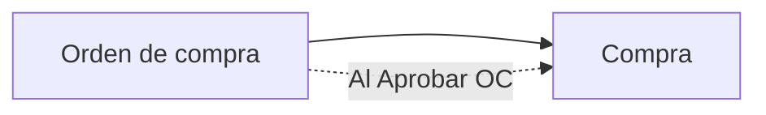

## Resumen

El flujo de compras en ZinK ERP organiza el proceso desde la solicitud al proveedor hasta el registro final de la compra.

Permite trabajar en etapas, manteniendo control y trazabilidad de cada operación.

---

## Antes de empezar

- Tener productos configurados.
- Tener proveedores cargados como contactos.
- Tener permisos para crear o editar órdenes de compra y compras.
- Para pagar al proveedor desde el flujo, el usuario debe tener permiso para **registrar pagos**.
- Definir días de vencimiento de pago por proveedor o desde preferencias.

---

## Flujo completo

Orden de compra → Compra

La flecha punteada indica que la **compra** puede generarse al **Aprobar** una orden o registrarse **directamente** sin orden previa.

### Ciclo de estados por documento

| Documento | Estado inicial | Estado final exitoso | Rechazar / Cancelar |
|-----------|----------------|----------------------|---------------------|
| [Orden de compra](./orden-compras.md) | Borrador | **Aprobado** (genera compra en Borrador) | Rechazar / Cancelar |
| [Compra](./compras.md) | Borrador | **Aprobado** (stock y CC) | Rechazar / Cancelar; etapa intermedia **Control** |

Acciones típicas de compra: **Confirmar** → (opcional) **Controlar** → **Aprobar**.

Para diferencias entre lo comprado y lo recibido, ver [Recepción de mercadería](./recepcion-mercaderia.md). Para devoluciones, [Notas de crédito de compras](./notas-credito-compras.md).

Los formularios rediseñados (cabecera, ítems, F2/F4) se explican una sola vez en [Formulario de documento V2](../guias/formulario-documento-v2.md).

---

## Cómo funciona el flujo

Cada etapa permite avanzar en el proceso:

- Se registra lo que se necesita comprar (orden)
- Se aprueba la orden y nace la compra en borrador (o se carga la compra directa)
- Se confirma, controla si hace falta y se **aprueba** la compra (impacto en el sistema)

Esto permite:

- control de compras
- trazabilidad
- organización operativa

---

## Etapas del proceso

### Orden de compra

- Representa lo que se solicita al proveedor
- Permite definir cantidades y condiciones
- No impacta stock ni cuenta corriente
- Al **Aprobar** genera la compra asociada en **Borrador**

👉 Funciona como propuesta o planificación de compra

---

### Compra

- Representa la operación final
- Impacta stock y cuenta corriente al **Aprobar**
- Puede ofrecer registrar el pago al proveedor si hay importe pendiente y el usuario tiene permiso
- Por ítem podés indicar **Actualiza Costo**; si el producto tiene recálculo de precios activo, se actualizan las listas automáticas. Ver [Compras](./compras.md#actualizar-costo-desde-la-compra).

---

## Qué cambia en cada etapa

| Etapa | Stock | Cuenta corriente | Objetivo |
|-------|------|------------------|----------|
| Orden de compra | ❌ | ❌ | Planificar → Aprobar genera compra |
| Compra (hasta Confirmado/Control) | ❌ | ❌ | Revisar |
| Compra **Aprobado** | ✔️ | ✔️ | Ejecutar |

---

## Permisos en el flujo

Cada etapa puede tener permisos propios para ver, crear, editar, eliminar o avanzar. Tener acceso a Compras no implica necesariamente poder crear órdenes, editar compras o registrar pagos.

Para diagnosticar un bloqueo, separá el problema en dos preguntas:

| Pregunta | Dónde revisar |
|----------|---------------|
| ¿El usuario puede entrar a la pantalla? | Permiso de menú o visualización. |
| ¿El usuario puede ejecutar la acción? | Permiso específico de acción, por ejemplo crear, editar, confirmar, controlar, aprobar o registrar pagos. |

El pago a proveedores depende del permiso para **registrar pagos**. La explicación general de permisos está centralizada en [Perfiles](../administracion/perfiles.md).

---

## Casos frecuentes

### Compra planificada

Se genera una orden, se **Aprueba** y nace la compra en borrador; luego se confirma/controla/aprueba la compra.

### Compra directa

Se registra la compra sin orden previa.

### Compra con pago posterior

Se aprueba la compra y la deuda queda pendiente en la cuenta corriente del proveedor hasta que se cargue el pago.

---

## Si algo sale mal

- **Datos incorrectos**
  - Revisá información antes de confirmar o aprobar.
  - Si la compra ya avanzó de estado, puede no ser editable.
- **Problemas de stock**
  - Verificá productos y cantidades antes de **Aprobar**.
- **No podés registrar el pago**
  - Revisá permiso para registrar pagos.
  - Verificá que la compra tenga importe pendiente.
- **No podés avanzar desde la orden**
  - La orden debe estar **Aprobada** para generar la compra asociada (no alcanza con Confirmado).

---

## Buenas prácticas

- Usá órdenes de compra para planificar; **Aprobá** la orden cuando quieras generar la compra.
- Verificá cantidades y precios antes de aprobar la compra.
- Si el pago es posterior, controlá la deuda en [Cuenta corriente](../finanzas/cuenta-corriente.md).

---

## Ver también

- [Tutorial en video: flujo de compras](../guias/tutorial-flujo-de-compras.mdx)
- [Formulario de documento V2](../guias/formulario-documento-v2.md)
- [Órdenes de compra](./orden-compras.md)
- [Compras](./compras.md)
- [Recepción de mercadería](./recepcion-mercaderia.md)
- [Notas de crédito de compras](./notas-credito-compras.md)
- [Pagos](../finanzas/pagos.md)
- [Cuenta corriente](../finanzas/cuenta-corriente.md)
