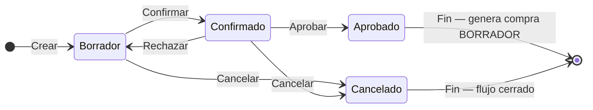

## Resumen

Las órdenes de compra permiten registrar lo que se le solicita a un proveedor antes de concretar la compra.

Funcionan como una instancia de planificación y control, donde se definen productos, cantidades y condiciones antes del impacto real en el sistema.

No impactan stock ni cuenta corriente.

---

## Antes de empezar

- Tener proveedores cargados como contactos.
- Verificá que los productos estén configurados.
- Algunas modificaciones pueden requerir permisos especiales.
- Tener permiso para crear o editar órdenes de compra.

---

## Ubicación dentro del flujo

Orden de compra → Compra

La orden de compra representa la etapa inicial del proceso.

👉 Al concretar la operación, se registra la compra.

---

## Cuándo usar órdenes de compra

Usá órdenes de compra cuando:

- Necesitás solicitar productos a un proveedor.
- Querés planificar compras antes de ejecutarlas.
- Trabajás con reposición de stock.
- Necesitás dejar registro de lo solicitado.

---

## Qué cambia y qué no cambia

**La orden de compra:**

- ✔️ Define qué se le solicita al proveedor
- ✔️ Permite organizar compras
- ✔️ Funciona como referencia de compra
- ❌ No impacta stock
- ❌ No genera deuda

👉 El impacto ocurre al registrar la compra.

---

## Procedimiento

1. Creá una nueva orden de compra (formulario **V2** si está activo; ver [Formulario de documento V2](../guias/formulario-documento-v2.md)).
2. Seleccioná el **proveedor** (contacto).
3. Completá **Fecha Orden de Compra** y, si corresponde, **Enviar comprobante**.
4. Agregá ítems con **Agregar Items**, **Listado (F4)** o escaneo/búsqueda. Podés usar **Stock crítico** y **Faltantes** como ayudas.
5. Revisá precios, cantidades y observación.
6. Guardá con **Guardar (F2)** y confirmá el diálogo **GUARDAR ORDEN DE COMPRA**.
7. En el listado, avanzá estados según el circuito (Confirmar → Aprobar).
8. Al **Aprobar**, el sistema genera una [compra](./compras.md) en **Borrador**.

### Atajos en el formulario

| Tecla | Acción |
|-------|--------|
| **F2** | Guardar |
| **F4** | Listado de productos |
| **Enter** | De producto a precio en la línea |
| **Esc** | Cancelar diálogo |

Los atajos **/** y **\*** del chip de accesos **no** están operativos en órdenes de compra.

---

## Relación con la compra

La orden de compra no mueve stock ni genera deuda. Su función es dejar preparada la solicitud al proveedor.

Al **Aprobar** la orden se genera la compra asociada en **Borrador**. El impacto de stock y cuenta corriente ocurre cuando esa compra se **Aprueba**.

| Documento | Qué representa | Impacto |
|-----------|----------------|---------|
| Orden de compra | Solicitud o planificación | No impacta stock ni cuenta corriente. |
| Compra | Operación final con proveedor | Al **Aprobar**: ingresa stock y puede generar deuda o pago. |

Si la mercadería llega con diferencias, revisá cantidades y precios antes de aprobar la compra final.

---

## Estados

| Estado | Descripción |
|--------|-------------|
| **Borrador** | Editable. |
| **Confirmado** | Orden confirmada; aún no genera la compra. |
| **Aprobado** | Estado final exitoso: genera [compra](./compras.md) en **Borrador**. |
| **Cancelado** | Flujo cerrado. |

### Acciones del listado

| Acción | Efecto |
|--------|--------|
| **Confirmar** | Pasa de Borrador a Confirmado. |
| **Aprobar** | Pasa a Aprobado y genera la compra asociada en Borrador. |
| **Rechazar** | Vuelve atrás en el circuito (hacia editable), según el estado actual. |
| **Cancelar** | Cierra el flujo en Cancelado. |

### Ciclo de vida

**Estado inicial:** Borrador · **Estado final (éxito):** Aprobado · **Cierre sin éxito:** Cancelado.

---

## Casos frecuentes

### Reposición de stock

Se generan órdenes para mantener niveles de inventario.

### Planificación de compras

Permite organizar pedidos antes de ejecutarlos.

### Control con proveedores

Sirve como registro de lo solicitado.

---

## Recomendaciones de uso

Las órdenes de compra son ideales para mantener control sobre lo que se solicita a proveedores antes de impactar el sistema.

Usalas cuando:

- Querés planificar compras
- Necesitás aprobación interna
- Trabajás con proveedores recurrentes

👉 Evitá registrar compras directamente si necesitás control previo.

---

## Si algo sale mal

- **Datos incorrectos**
  - Revisá productos y cantidades antes de confirmar.

- **Proveedor incorrecto**
  - Verificá el contacto seleccionado.

- **No podés generar o editar la orden**
  - Revisá los permisos del perfil.
  - Confirmá que la orden no esté en un estado cerrado.

---

## Buenas prácticas

- Confirmá la orden antes de enviarla.
- Revisá cantidades y condiciones.
- Usá observaciones para acuerdos con proveedores.
- Mantené consistencia entre orden y compra final.

---

## Ver también

- [Compras](./compras.md)
- [Flujo de compras](./flujo-compras.md)
- [Formulario de documento V2](../guias/formulario-documento-v2.md)
- [Productos](../administracion/productos.md)
- [Perfiles](../administracion/perfiles.md)
