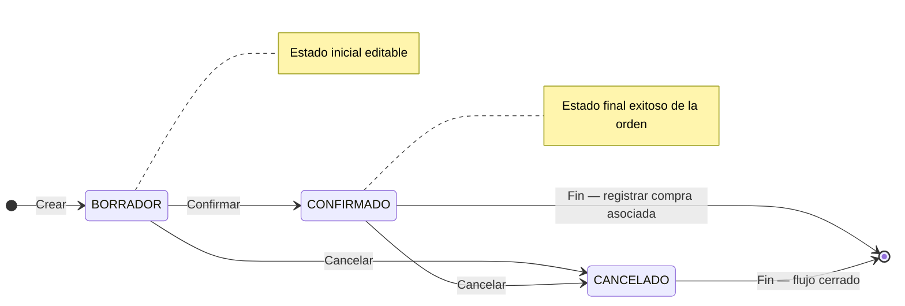

## Resumen

Las órdenes de compra permiten registrar lo que se le solicita a un proveedor antes de concretar la compra.

Funcionan como una instancia de planificación y control, donde se definen productos, cantidades y condiciones antes del impacto real en el sistema.

No impactan stock ni cuenta corriente.

---

## Antes de empezar

- Tener proveedores cargados como contactos.
- Verificá que los productos estén configurados.
- Algunas modificaciones pueden requerir permisos especiales.
- Tener permiso para crear o editar órdenes de compra.

---

## Ubicación dentro del flujo

Orden de compra → Compra

La orden de compra representa la etapa inicial del proceso.

👉 Al concretar la operación, se registra la compra.

---

## Cuándo usar órdenes de compra

Usá órdenes de compra cuando:

- Necesitás solicitar productos a un proveedor.
- Querés planificar compras antes de ejecutarlas.
- Trabajás con reposición de stock.
- Necesitás dejar registro de lo solicitado.

---

## Qué cambia y qué no cambia

**La orden de compra:**

- ✔️ Define qué se le solicita al proveedor
- ✔️ Permite organizar compras
- ✔️ Funciona como referencia de compra
- ❌ No impacta stock
- ❌ No genera deuda

👉 El impacto ocurre al registrar la compra.

---

## Procedimiento

1. Creá una nueva orden de compra.
2. Seleccioná el proveedor.
3. Agregá productos y cantidades.
4. Revisá condiciones (precios, fechas, observaciones).
5. Confirmá la orden.
6. Enviá al proveedor si corresponde.
7. Cuando se concreta:
   - Registrá la compra asociada

---

## Relación con la compra

La orden de compra no mueve stock ni genera deuda. Su función es dejar preparada la solicitud al proveedor.

El impacto real ocurre cuando se registra la compra:

| Documento | Qué representa | Impacto |
|-----------|----------------|---------|
| Orden de compra | Solicitud o planificación | No impacta stock ni cuenta corriente. |
| Compra | Operación final con proveedor | Ingresa stock y puede generar deuda o pago. |

Si la mercadería llega con diferencias, revisá cantidades y precios antes de registrar la compra final.

---

## Estados

| Estado     | Descripción |
|------------|------------|
| BORRADOR   | Editable. |
| CONFIRMADO | Lista para enviar o ejecutar. |
| CANCELADO  | Flujo cerrado. |

### Ciclo de vida

**Estado inicial:** BORRADOR · **Estado final (éxito):** CONFIRMADO (listo para registrar la compra) · **Cierre sin éxito:** CANCELADO.

No aplica **Rechazar**; para anular una orden confirmada usá **Cancelar**.

---

## Casos frecuentes

### Reposición de stock

Se generan órdenes para mantener niveles de inventario.

### Planificación de compras

Permite organizar pedidos antes de ejecutarlos.

### Control con proveedores

Sirve como registro de lo solicitado.

---

## Recomendaciones de uso

Las órdenes de compra son ideales para mantener control sobre lo que se solicita a proveedores antes de impactar el sistema.

Usalas cuando:

- Querés planificar compras
- Necesitás aprobación interna
- Trabajás con proveedores recurrentes

👉 Evitá registrar compras directamente si necesitás control previo.

---

## Si algo sale mal

- **Datos incorrectos**
  - Revisá productos y cantidades antes de confirmar.

- **Proveedor incorrecto**
  - Verificá el contacto seleccionado.

- **No podés generar o editar la orden**
  - Revisá los permisos del perfil.
  - Confirmá que la orden no esté en un estado cerrado.

---

## Buenas prácticas

- Confirmá la orden antes de enviarla.
- Revisá cantidades y condiciones.
- Usá observaciones para acuerdos con proveedores.
- Mantené consistencia entre orden y compra final.

---

## Ver también

- [Compras](./compras.md)
- [Flujo de compras](./flujo-compras.md)
- [Productos](../administracion/productos.md)
- [Perfiles](../administracion/perfiles.md)
