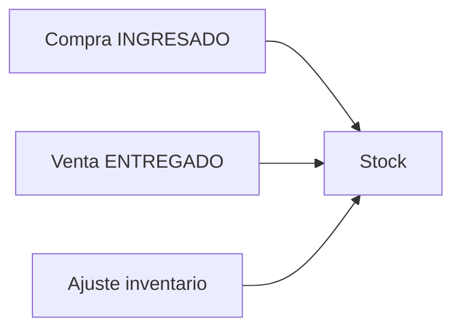

## Resumen

El módulo de inventario te permite conocer y corregir el stock: movimientos por compras y ventas, ajustes cuando no hay documento comercial, toma por ubicación y consulta entre organizaciones.

---

## Para qué sirve inventario

Inventario no reemplaza ventas ni compras. Sirve para corregir, validar o consultar stock cuando el cambio no debe resolverse con un documento comercial.

Ejemplos típicos:

- ajuste inicial;
- rotura o pérdida;
- diferencia detectada en depósito;
- recuento físico;
- consulta de disponibilidad entre organizaciones.

---

## ¿Qué artículo necesito?

| Necesito… | Artículo |
|-----------|----------|
| Corregir stock sin compra/venta (rotura, inicial, ajuste) | [Registro de inventario](./inventarios.md) |
| Contar o ajustar por ubicación en depósito | [Toma de inventario](./inventarios-ubicacion.md) |
| Consultar stock en otra organización | [Consulta de stock inter-org](./productos-consulta-inter-org.md) |

---

## Cómo se conecta con el resto

Las compras **ingresan** stock; las ventas **entregadas** lo descuentan; el registro de inventario corrige cuando no corresponde usar compra o venta.

---

## Antes de empezar

- Tener [productos](../administracion/productos.md) configurados.
- Verificar permisos de inventario en [Perfiles](../administracion/perfiles.md).
- Antes de un ajuste manual, revisá si el error viene de una [compra](../compras/compras.md) o [venta](../ventas/ventas.md) mal registrada.

---

## Cómo elegir el artículo correcto

- Si necesitás **corregir stock** sin compra ni venta, usá [Registro de inventario](./inventarios.md).
- Si necesitás **contar físicamente** por ubicación, usá [Toma de inventario](./inventarios-ubicacion.md).
- Si necesitás **ver stock en otra organización**, usá [Consulta de stock inter-org](./productos-consulta-inter-org.md).

---

## Buenas prácticas

- No ajustes “porque falta” sin revisar antes el origen.
- Separá los recuentos físicos de los movimientos comerciales.
- Registrá las diferencias con criterio operativo para poder auditarlas después.

---

## Si algo sale mal

- **El stock no coincide con el depósito**
  - Revisá movimientos recientes en el historial del producto.
  - Verificá compras en **INGRESADO** y ventas en **ENTREGADO**.
- **No puedo ajustar**
  - Revisá permisos de agregar/editar inventario.

---

## Preguntas frecuentes

### ¿Conviene corregir stock desde el producto?

Solo para casos muy puntuales de carga inicial. Para operación diaria conviene dejar trazabilidad con [Registro de inventario](./inventarios.md).

### ¿Cuándo usar toma de inventario y no ajuste manual?

Cuando necesitás contar físicamente por sector, ubicación o depósito y dejar un recuento más ordenado.

---

## Ver también

- [Flujo de compras](../compras/flujo-compras.md)
- [Flujo de ventas](../ventas/flujo-ventas.md)
- [Informe Stock crítico](../informes/informe-stock-critico.md)
- [Productos](../administracion/productos.md)
