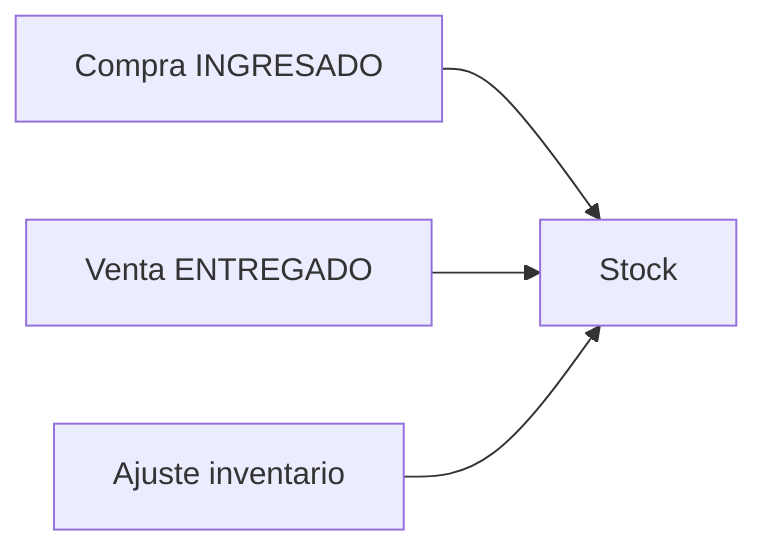

## Resumen

El módulo de inventario te permite conocer y corregir el stock: movimientos por compras y ventas, ajustes cuando no hay documento comercial, toma por ubicación y consulta entre organizaciones.

---

## ¿Qué artículo necesito?

| Necesito… | Artículo |
|-----------|----------|
| Corregir stock sin compra/venta (rotura, inicial, ajuste) | [Registro de inventario](./inventarios.md) |
| Contar o ajustar por ubicación en depósito | [Toma de inventario](./inventarios-ubicacion.md) |
| Consultar stock en otra organización | [Consulta de stock inter-org](./productos-consulta-inter-org.md) |

---

## Cómo se conecta con el resto

Las compras **ingresan** stock; las ventas **entregadas** lo descuentan; el registro de inventario corrige cuando no corresponde usar compra o venta.

---

## Antes de empezar

- Tener [productos](../administracion/productos.md) configurados.
- Verificar permisos de inventario en [Perfiles](../administracion/perfiles.md).
- Antes de un ajuste manual, revisá si el error viene de una [compra](../compras/compras.md) o [venta](../ventas/ventas.md) mal registrada.

---

## Si algo sale mal

- **El stock no coincide con el depósito**
  - Revisá movimientos recientes en el historial del producto.
  - Verificá compras en **INGRESADO** y ventas en **ENTREGADO**.
- **No puedo ajustar**
  - Revisá permisos de agregar/editar inventario.

---

## Ver también

- [Flujo de compras](../compras/flujo-compras.md)
- [Flujo de ventas](../ventas/flujo-ventas.md)
- [Informe Stock crítico](../informes/informe-stock-critico.md)
- [Productos](../administracion/productos.md)
