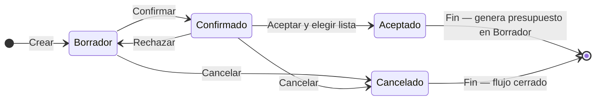

## Resumen

Las cotizaciones permiten armar una propuesta comercial mostrando múltiples listas de precios en simultáneo para que el cliente compare opciones.

Son la primera etapa del flujo de ventas y se utilizan cuando todavía no está definida la condición comercial.

No impactan stock ni cuenta corriente.

---

## Antes de empezar

- Tené configuradas las listas de precios.
- Verificá que los productos tengan precios cargados.
- Algunas modificaciones pueden requerir permisos especiales.

---

## Ubicación dentro del flujo

Cotización → Presupuesto → Pedido → Venta

La cotización representa la etapa inicial, donde el cliente evalúa opciones antes de tomar una decisión.

Al pasar a **Aceptado**, se genera un presupuesto en **Borrador**.

---

## Cuándo usar cotizaciones

Usá cotizaciones cuando:

- El cliente quiere comparar precios (mayorista, minorista, etc.).
- No está definida la lista de precios a aplicar.
- Estás en una etapa de negociación.
- Querés presentar varias opciones en una sola propuesta.

Si el precio ya está definido, conviene ir directamente a [Presupuestos](./presupuestos.md).

---

## Qué cambia y qué no cambia

**La cotización:**

- ✔️ Permite comparar listas de precios
- ✔️ Funciona como propuesta comercial
- ❌ No impacta stock
- ❌ No genera cuenta corriente
- ❌ No emite comprobantes

El impacto ocurre recién cuando se convierte en presupuesto.

---

## Procedimiento

1. Creá una nueva cotización (ver [Formulario de documentos](../guias/formulario-documento-v2.md)).
2. (Opcional) Seleccioná un **Contacto (Opcional)**.
3. Completá fechas compactas (**Cotización**, **Días vto**) si aplica.
4. Agregá productos con **Agregar Producto** o **Listado (F4)**. Cada ítem muestra **cantidad** y **una columna por lista de precios**.
5. Completá **Observaciones** debajo de los ítems si hace falta.
6. Guardá con **Guardar (F2)** y confirmá **GUARDAR COTIZACIÓN**.
7. En el listado, **Confirmá** la cotización.
8. Cuando el cliente define la opción:
   - **Aceptá** la cotización (diálogo **Aceptar cotización**)
   - Elegí la **Lista de precios** y **Crear Presupuesto**
   - El sistema genera un presupuesto en **Borrador**

### Atajos en el formulario

| Tecla | Acción |
|-------|--------|
| **F2** | Guardar |
| **F4** | Listado de productos |
| **Enter** | De producto a cantidad |
| **Esc** | Cancelar diálogo |

Los atajos **/** y **\*** del chip de accesos **no** están operativos en cotizaciones.

---

## Estados

| Estado | Descripción |
|--------|-------------|
| **Borrador** | Editable. |
| **Confirmado** | Propuesta confirmada o enviada. |
| **Aceptado** | Genera presupuesto en Borrador (eligiendo lista). |
| **Cancelado** | Flujo cerrado. |

### Acciones del listado

| Acción | Efecto |
|--------|--------|
| **Confirmar** | Borrador → Confirmado. |
| **Aceptar** | Confirmado → Aceptado; crea presupuesto eligiendo lista. |
| **Rechazar** | Vuelve a **Borrador**. |
| **Cancelar** | Cierra en Cancelado. |

### Ciclo de vida

**Estado inicial:** Borrador · **Estado final (éxito):** Aceptado (genera presupuesto en Borrador).

---

## Casos frecuentes

### El cliente quiere comparar opciones

Se muestran varias listas en una sola pantalla.

### No está definido el volumen de compra

Permite avanzar sin cerrar condiciones.

### Envío de propuesta comercial

Se comparte sin comprometer operación.

---

## Listado y preferencias

Usá la búsqueda de la grilla o el **filtro avanzado** (fechas, contacto, estado). En computadora, el menú **Columnas** permite mostrar u ocultar columnas sin eliminar datos.

Al final del menú Columnas podés marcar **“Recordar preferencias de este listado”** (también como **“Recordar filtro”** en el filtro avanzado). Si está activa, el sistema guarda en este navegador —por usuario y sucursal— el último filtro, las columnas visibles y las **filas por página** (50, 100 o 150).

No guarda anchos de columnas, orden de columnas, número de página, ordenamiento ni la búsqueda rápida. Si desmarcás la opción, deja de restaurar y se borra lo guardado para esa sucursal y pantalla.

---

## Duplicar y compartir

- **Duplicar**: desde **Más acciones** en el listado o con el botón **Duplicar** en el detalle, abrís una cotización nueva con el mismo contacto, productos y cantidades. Ver [Duplicar documentos](../guias/duplicar-documentos.md).
- **Compartir**: desde el detalle podés copiar un resumen, mandarlo por WhatsApp o email, o descargar el PDF. Ver [Compartir y enviar documentos](../guias/compartir-y-enviar-documentos.md).

---

## Si algo sale mal

- **No aparecen precios**
  - Verificá que las listas estén configuradas en [Preferencias](../configuracion/preferencias.md).
- **No podés modificar precios**
  - Puede requerir permisos especiales.
- **No podés pasar a Aceptado**
  - Verificá que tenga ítems cargados.
  - La cotización debe estar en **Confirmado** antes de aceptar.
  - Revisá permisos de la etapa en [Perfiles](../administracion/perfiles.md).

---

## Buenas prácticas

- Verificá listas antes de enviar.
- Usá observaciones para condiciones.
- Pasá a presupuesto en cuanto el cliente defina la lista.

---

## Ver también

- [Formulario de documentos](../guias/formulario-documento-v2.md)
- [Presupuestos](./presupuestos.md)
- [Flujo de ventas](./flujo-ventas.md)
- [Duplicar documentos](../guias/duplicar-documentos.md)
- [Compartir y enviar documentos](../guias/compartir-y-enviar-documentos.md)
