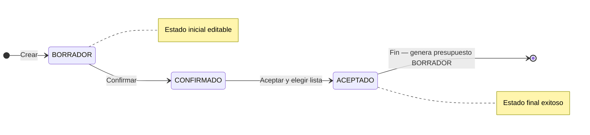

## Resumen

Las cotizaciones permiten armar una propuesta comercial mostrando múltiples listas de precios en simultáneo para que el cliente compare opciones.

Son la primera etapa del flujo de ventas y se utilizan cuando todavía no está definida la condición comercial.

No impactan stock ni cuenta corriente.

---

## Antes de empezar

- Tené configuradas las listas de precios.
- Verificá que los productos tengan precios cargados.
- Algunas modificaciones pueden requerir permisos especiales.

---

## Ubicación dentro del flujo

Cotización → Presupuesto → Pedido → Venta

La cotización representa la etapa inicial, donde el cliente evalúa opciones antes de tomar una decisión.

Al pasar a **ACEPTADO**, se genera un presupuesto en **BORRADOR**.

---

## Cuándo usar cotizaciones

Usá cotizaciones cuando:

- El cliente quiere comparar precios (mayorista, minorista, etc.).
- No está definida la lista de precios a aplicar.
- Estás en una etapa de negociación.
- Querés presentar varias opciones en una sola propuesta.

Si el precio ya está definido, conviene ir directamente a [Presupuestos](./presupuestos.md).

---

## Qué cambia y qué no cambia

**La cotización:**

- ✔️ Permite comparar listas de precios
- ✔️ Funciona como propuesta comercial
- ❌ No impacta stock
- ❌ No genera cuenta corriente
- ❌ No emite comprobantes

El impacto ocurre recién cuando se convierte en presupuesto.

---

## Procedimiento

1. Creá una nueva cotización.
2. (Opcional) Seleccioná un contacto.
3. Agregá productos y cantidades.
4. Visualizá los precios en las distintas listas.
5. Ajustá observaciones si es necesario.
6. Compartí la cotización con el cliente.
7. Confirmá la cotización (estado **CONFIRMADO**).
8. Cuando el cliente define la opción:
   - Aceptá la cotización (estado **ACEPTADO**)
   - Elegí la lista de precios a aplicar
   - El sistema genera un presupuesto en **BORRADOR**

---

## Estados

| Estado      | Descripción |
|-------------|------------|
| BORRADOR    | Editable. |
| CONFIRMADO  | Propuesta confirmada o enviada. |
| ACEPTADO    | Genera presupuesto en BORRADOR. |

### Ciclo de vida

**Estado inicial:** BORRADOR · **Estado final (éxito):** ACEPTADO (genera presupuesto en BORRADOR).

En cotizaciones no figura la acción **Rechazar**; el avance es lineal: **BORRADOR** → **CONFIRMADO** → **ACEPTADO**.

---

## Casos frecuentes

### El cliente quiere comparar opciones

Se muestran varias listas en una sola pantalla.

### No está definido el volumen de compra

Permite avanzar sin cerrar condiciones.

### Envío de propuesta comercial

Se comparte sin comprometer operación.

---

## Listado y preferencias

Usá la búsqueda de la grilla o el **filtro avanzado** (fechas, contacto, estado). En computadora, el menú **Columnas** permite mostrar u ocultar columnas sin eliminar datos.

Al final del menú Columnas podés marcar **“Recordar preferencias de este listado”** (también como **“Recordar filtro”** en el filtro avanzado). Si está activa, el sistema guarda en este navegador —por usuario y sucursal— el último filtro, las columnas visibles y las **filas por página** (50, 100 o 150).

No guarda anchos de columnas, orden de columnas, número de página, ordenamiento ni la búsqueda rápida. Si desmarcás la opción, deja de restaurar y se borra lo guardado para esa sucursal y pantalla.

---

## Si algo sale mal

- **No aparecen precios**
  - Verificá que las listas estén configuradas en [Preferencias](../configuracion/preferencias.md).
- **No podés modificar precios**
  - Puede requerir permisos especiales.
- **No podés pasar a ACEPTADO**
  - Verificá que tenga ítems cargados.
  - La cotización debe estar en **CONFIRMADO** antes de aceptar.
  - Revisá permisos de la etapa en [Perfiles](../administracion/perfiles.md).

---

## Buenas prácticas

- Verificá listas antes de enviar.
- Usá observaciones para condiciones.
- Pasá a presupuesto en cuanto el cliente defina la lista.

---

## Ver también

- [Presupuestos](./presupuestos.md)
- [Flujo de ventas](./flujo-ventas.md)
