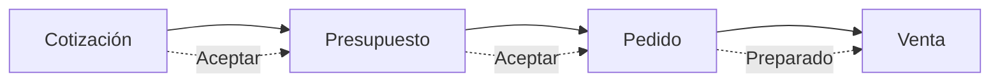
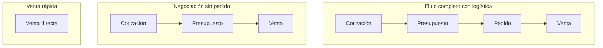

## Resumen

El flujo de ventas en Zink ERP organiza el proceso comercial desde una propuesta inicial hasta la concreción de la venta.

Está dividido en etapas que permiten avanzar progresivamente según el nivel de definición de la operación.

Cada vez que avanzás en el flujo, el sistema genera automáticamente el siguiente documento en estado BORRADOR y mantiene la relación entre ellos.

---

## Antes de empezar

- Tener productos configurados.
- Tener contactos (clientes) cargados.
- Definir listas de precios.
- Tener permisos para crear o editar la etapa que corresponda.
- Para cerrar una venta con cobro, el usuario debe tener permiso para **realizar cobro en ventas**.

---

## Flujo completo

Cotización → Presupuesto → Pedido → Venta

Cada flecha punteada representa la **generación automática** del siguiente documento en estado **BORRADOR**.

### Variantes del flujo

---

## Cómo funciona el flujo

Cada vez que avanzás en el proceso:

- Se genera un nuevo documento
- El nuevo documento queda en estado BORRADOR
- Se mantiene la relación con el documento anterior

Esto permite:

- trazabilidad completa de la operación
- control por etapas
- posibilidad de ajustar antes de cerrar la venta

---

## Etapas del proceso

### Cotización

- Comparación de precios entre listas
- Negociación con el cliente
- No impacta stock ni cuenta corriente

👉 Al aceptar, se genera un presupuesto en estado BORRADOR.

---

### Presupuesto

- Precio definido
- Condiciones comerciales
- Vigencia de la propuesta

👉 Al aceptar, se genera un pedido en estado BORRADOR.

---

### Pedido

- Representa el compromiso del cliente
- Permite organizar la preparación o logística

👉 Al completar, se genera la venta en estado BORRADOR.

---

### Venta

- Cierre de la operación
- Impacta stock
- Impacta cuenta corriente
- Puede abrir el cobro si el cliente o la configuración requieren pago inmediato

---

## Qué cambia en cada etapa

| Etapa        | Stock | Cuenta corriente | Objetivo |
|--------------|------|------------------|----------|
| Cotización   | ❌   | ❌               | Comparar |
| Presupuesto  | ❌   | ❌               | Formalizar |
| Pedido       | ❌   | ❌               | Preparar |
| Venta        | ✔️   | ✔️               | Ejecutar |

---

## Permisos en el flujo

Cada etapa puede tener permisos propios para ver, crear, editar, eliminar o avanzar. Tener acceso a Ventas no implica necesariamente poder crear cotizaciones, editar pedidos o registrar cobros.

Para diagnosticar un bloqueo, separá el problema en dos preguntas:

| Pregunta | Dónde revisar |
|----------|---------------|
| ¿El usuario puede entrar a la pantalla? | Permiso de menú o visualización de la etapa. |
| ¿El usuario puede ejecutar la acción? | Permiso específico de acción, por ejemplo crear, editar, confirmar o cobrar. |

El cobro en POS y en ventas comerciales depende del permiso para **realizar cobro en ventas**. La explicación completa de permisos está centralizada en [Perfiles](../administracion/perfiles.md).

---

## Casos frecuentes

### Venta rápida

Podés ir directamente a venta sin pasar por etapas previas.

### Venta con negociación

Cotización → Presupuesto → Venta

### Venta con logística

Cotización → Presupuesto → Pedido → Venta

---

## Ciclo de estados por documento

Cada etapa tiene su propio ciclo de vida. En presupuesto, pedido y venta, **Rechazar** devuelve el documento a **BORRADOR** (estado inicial editable). El detalle está en el artículo de cada entidad.

| Documento   | Estado inicial | Estado final exitoso | Al rechazar      |
|-------------|----------------|----------------------|------------------|
| Cotización  | BORRADOR       | ACEPTADA             | —                |
| Presupuesto | BORRADOR       | ACEPTADO             | Vuelve a BORRADOR |
| Pedido      | BORRADOR       | PREPARADO            | Vuelve a BORRADOR |
| Venta       | BORRADOR       | ENTREGADO            | Vuelve a BORRADOR |

---

## Si algo sale mal

- **No podés avanzar de etapa**
  - Verificá el estado del documento.
  - Revisá el permiso de acción correspondiente a esa etapa.

- **Datos incorrectos en la venta**
  - Revisá la información en las etapas anteriores.

- **Problemas con stock**
  - Verificá la configuración de los productos.

---

## Ver también

- [Cotizaciones](./cotizaciones.md)
- [Presupuestos](./presupuestos.md)
- [Pedidos](./pedidos.md)
- [Ventas](./ventas.md)
