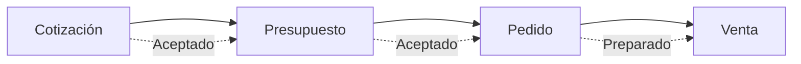
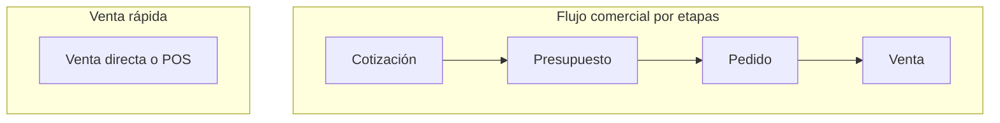

## Resumen

El flujo de ventas en Zink ERP organiza el proceso comercial desde una propuesta inicial hasta la concreción de la venta.

Está dividido en etapas que permiten avanzar progresivamente según el nivel de definición de la operación.

Cada vez que avanzás en el flujo, el sistema genera automáticamente el siguiente documento en estado Borrador y mantiene la relación entre ellos.

---

## Antes de empezar

- Tener productos configurados.
- Tener contactos (clientes) cargados.
- Definir listas de precios.
- Tener permisos para crear o editar la etapa que corresponda.
- Para cerrar una venta con cobro, el usuario debe tener permiso para **realizar cobro en ventas**.

---

## Flujo completo

Cotización → Presupuesto → Pedido → Venta

Cada flecha punteada representa la **generación automática** del siguiente documento en estado **Borrador**.

### Variantes del flujo

No existe un atajo del sistema que genere **venta** desde **presupuesto** sin pasar por **pedido**. En el flujo por etapas, la venta se crea al marcar el pedido como **Preparado** (en **Borrador**) o podés registrar una **venta directa** / **POS** sin etapas previas.

---

## Cómo funciona el flujo

Cada vez que avanzás en el proceso:

- Se genera un nuevo documento
- El nuevo documento queda en estado Borrador
- Se mantiene la relación con el documento anterior

Esto permite trazabilidad completa, control por etapas y ajustes antes de cerrar la venta.

---

## Etapas del proceso

### Cotización

- Comparación de precios entre listas
- Negociación con el cliente
- No impacta stock ni cuenta corriente
- Acciones: Confirmar · Aceptar · **Rechazar** · Cancelar

Cuando el cliente elige lista y condiciones, **Aceptá** la cotización (debe estar **Confirmado**). El sistema genera un presupuesto en **Borrador**. Detalle en [Cotizaciones](./cotizaciones.md).

---

### Presupuesto

- Precio definido
- Condiciones comerciales
- Vigencia de la propuesta

Al **Aceptar**, se genera un pedido en **Borrador**. Detalle en [Presupuestos](./presupuestos.md).

---

### Pedido

- Representa el compromiso del cliente
- Permite organizar la preparación o logística

Usá **Preparar** → **Confirmar preparado**. Al quedar **Preparado**, se genera la venta en **Borrador**. Detalle en [Pedidos](./pedidos.md).

---

### Venta

- Cierre de la operación
- Impacta stock (al **Entregado**)
- Impacta cuenta corriente
- Puede abrir el cobro si el cliente o la configuración requieren pago inmediato
- Despacho: acción **Despachar** → estado **Despachado**

Detalle en [Ventas](./ventas.md). Los formularios de documentos (excepto POS) se explican en [Formulario de documentos](../guias/formulario-documento-v2.md).

---

## Qué cambia en cada etapa

| Etapa        | Stock | Cuenta corriente | Objetivo |
|--------------|------|------------------|----------|
| Cotización   | ❌   | ❌               | Comparar |
| Presupuesto  | ❌   | ❌               | Formalizar |
| Pedido       | ❌   | ❌               | Preparar |
| Venta        | ✔️   | ✔️               | Ejecutar |

---

## Permisos en el flujo

Cada etapa puede tener permisos propios para ver, crear, editar, eliminar o avanzar. Tener acceso a Ventas no implica necesariamente poder crear cotizaciones, editar pedidos o registrar cobros.

| Pregunta | Dónde revisar |
|----------|---------------|
| ¿El usuario puede entrar a la pantalla? | Permiso de menú o visualización de la etapa. |
| ¿El usuario puede ejecutar la acción? | Permiso específico de acción, por ejemplo crear, editar, confirmar o cobrar. |

El cobro en POS y en ventas comerciales depende del permiso para **realizar cobro en ventas**. Ver [Perfiles](../administracion/perfiles.md).

---

## Casos frecuentes

### Venta rápida

Podés ir directamente a [Ventas](./ventas.md) o usar [POS](./pos.md) sin pasar por etapas previas.

### Venta con negociación por etapas

Cotización → Presupuesto → Pedido → Venta (no podés saltar el pedido desde el flujo).

### Venta con preparación o logística

Mismo recorrido por etapas; el pedido organiza la preparación antes de la venta.

---

## Ciclo de estados por documento

| Documento   | Estado inicial | Estado final exitoso | Al rechazar      |
|-------------|----------------|----------------------|------------------|
| Cotización  | Borrador       | Aceptado             | —                |
| Presupuesto | Borrador       | Aceptado             | Vuelve a Borrador |
| Pedido      | Borrador       | Preparado            | Vuelve a Borrador |
| Venta       | Borrador       | Entregado            | Vuelve a Borrador |

El detalle de cada ciclo está en el artículo de la entidad.

---

## Si algo sale mal

- **No podés avanzar de etapa**
  - Verificá el estado del documento.
  - Revisá el permiso de acción correspondiente a esa etapa.
- **No aparece la acción para avanzar**
  - Separá permiso de menú vs permiso de acción (crear, confirmar, aceptar, preparar, cobrar).
- **El documento hijo no se generó**
  - Verificá que el padre esté en el estado final de su etapa (cotización **Aceptado**, presupuesto **Aceptado**, pedido **Preparado**).
- **Datos incorrectos en la venta**
  - Revisá la información en las etapas anteriores.
- **Problemas con stock**
  - Verificá la configuración de los productos y el estado **Entregado** de la venta.

---

## Buenas prácticas

- No confirmes una etapa si los precios o cantidades aún se negocian: usá cotización o presupuesto según corresponda.
- Antes de marcar un pedido como **Preparado**, revisá stock disponible en depósito.
- Registrá el cobro en el momento solo cuando el cliente y las preferencias lo exijan; si no, la deuda queda trazable en cuenta corriente.

---

## Ver también

- [Tutorial en video: flujo de ventas](../guias/tutorial-flujo-de-ventas.mdx)
- [Cotizaciones](./cotizaciones.md)
- [Presupuestos](./presupuestos.md)
- [Pedidos](./pedidos.md)
- [Ventas](./ventas.md)
- [POS](./pos.md)
