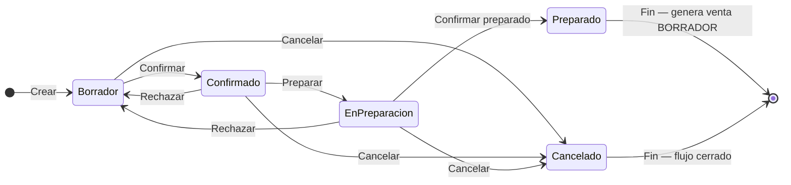

## Resumen

Los pedidos representan una compra confirmada por el cliente y permiten organizar la preparación de la mercadería antes de concretar la venta.

Son la etapa operativa del flujo de ventas, donde se ejecuta la preparación o logística.

---

## Antes de empezar

- El contacto no puede ser Consumidor Final.
- Verificá que los productos tengan precios válidos.
- Algunas modificaciones pueden requerir permisos especiales.

---

## Ubicación dentro del flujo

Cotización → Presupuesto → Pedido → Venta

El pedido representa el compromiso del cliente y el inicio de la operación.

👉 Al completarse, genera una venta en BORRADOR.

---

## Cuándo usar pedidos

Usá pedidos cuando:

- El cliente confirmó la compra.
- Necesitás preparar mercadería.
- Trabajás con depósito o picking.
- Querés separar operación de venta.

---

## Qué cambia y qué no cambia

**El pedido:**

- ✔️ Organiza la preparación
- ✔️ Representa compromiso de compra
- ✔️ Permite generar venta
- ❌ No impacta stock directamente
- ❌ No genera deuda

👉 El impacto ocurre en la venta.

---

## Procedimiento

1. Creá un pedido (formulario **V2**: [Formulario de documento V2](../guias/formulario-documento-v2.md)).
2. Seleccioná el contacto (no puede ser Consumidor Final).
3. Completá **Pedido**, **Entrega** y totales (descuento, recargo, envío) si aplica.
4. Agregá ítems (**F4** listado; **/** y **\*** con accesos rápidos).
5. Guardá (**F2**) y **Confirmá** el pedido.
6. Usá **Preparar** (pasa a **En preparación**).
7. Cuando esté listo, **Confirmar preparado**:
   - Se genera la venta en **Borrador**

---

## Estados

| Estado | Descripción |
|--------|-------------|
| **Borrador** | Editable. |
| **Confirmado** | Listo para preparación. |
| **En preparación** | En picking (acción **Preparar**). |
| **Preparado** | Genera venta en Borrador (acción **Confirmar preparado**). |
| **Rechazado** / **Cancelado** | Cierre o vuelta atrás según acción. |

Acciones del listado: **Confirmar** · **Preparar** · **Confirmar preparado** · **Rechazar** · **Cancelar**.

### Ciclo de vida

**Estado inicial:** Borrador · **Estado final (éxito):** Preparado · **Al rechazar:** vuelve a editable · **Cierre sin éxito:** Cancelado.

---

## Casos frecuentes

### Preparación en depósito
Se utiliza para organizar picking.

### Venta diferida
Se separa preparación de la venta final.

---

## Recomendaciones de uso

Los pedidos son ideales para operaciones donde la venta no es inmediata.

Usalos cuando:

- Hay logística o preparación
- Se trabaja con stock en depósito
- La entrega no es instantánea

👉 Evitá usarlos para ventas rápidas (usar POS).

---

## Si algo sale mal

- **No podés avanzar de estado**
  - Verificá la secuencia: **Confirmado** → **Preparar** (**En preparación**) → **Confirmar preparado**.
  - Revisá permisos de la etapa en [Perfiles](../administracion/perfiles.md).
- **No se genera la venta**
  - El pedido debe estar en **Preparado**.
  - El contacto no puede ser Consumidor Final (regla de pedidos).
- **Faltantes en la entrega**
  - Revisá el informe [Productos faltantes](../informes/informe-productos-faltantes.md) si hay diferencia entre pedido y venta.

---

## Buenas prácticas

- Confirmá antes de preparar.
- Revisá cantidades.
- Usá estados correctamente.

---

## Ver también

- [Formulario de documento V2](../guias/formulario-documento-v2.md)
- [Presupuestos](./presupuestos.md)
- [Ventas](./ventas.md)
- [Flujo de ventas](./flujo-ventas.md)
