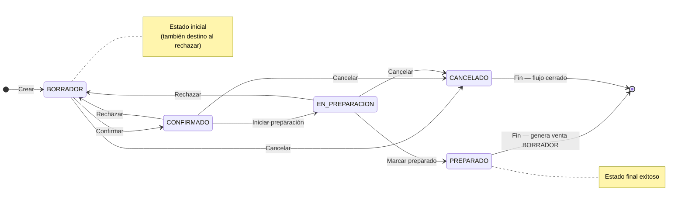

## Resumen

Los pedidos representan una compra confirmada por el cliente y permiten organizar la preparación de la mercadería antes de concretar la venta.

Son la etapa operativa del flujo de ventas, donde se ejecuta la preparación o logística.

---

## Antes de empezar

- El contacto no puede ser Consumidor Final.
- Verificá que los productos tengan precios válidos.
- Algunas modificaciones pueden requerir permisos especiales.

---

## Ubicación dentro del flujo

Cotización → Presupuesto → Pedido → Venta

El pedido representa el compromiso del cliente y el inicio de la operación.

👉 Al completarse, genera una venta en BORRADOR.

---

## Cuándo usar pedidos

Usá pedidos cuando:

- El cliente confirmó la compra.
- Necesitás preparar mercadería.
- Trabajás con depósito o picking.
- Querés separar operación de venta.

---

## Qué cambia y qué no cambia

**El pedido:**

- ✔️ Organiza la preparación
- ✔️ Representa compromiso de compra
- ✔️ Permite generar venta
- ❌ No impacta stock directamente
- ❌ No genera deuda

👉 El impacto ocurre en la venta.

---

## Procedimiento

1. Creá un pedido.
2. Seleccioná el contacto.
3. Agregá productos y cantidades.
4. Confirmá el pedido.
5. Pasá a EN_PREPARACION.
6. Prepará la mercadería.
7. Marcá como PREPARADO:
   - Se genera la venta en BORRADOR

---

## Estados

| Estado         | Descripción |
|----------------|------------|
| BORRADOR       | Editable. |
| CONFIRMADO     | Listo para preparación. |
| EN_PREPARACION | En picking. |
| PREPARADO      | Genera venta en BORRADOR. |
| RECHAZAR       | Vuelve a BORRADOR. |
| CANCELADO      | Flujo cerrado. |

### Ciclo de vida

**Estado inicial:** BORRADOR · **Estado final (éxito):** PREPARADO · **Al rechazar:** vuelve a **BORRADOR** · **Cierre sin éxito:** CANCELADO.

---

## Casos frecuentes

### Preparación en depósito
Se utiliza para organizar picking.

### Venta diferida
Se separa preparación de la venta final.

---

## Recomendaciones de uso

Los pedidos son ideales para operaciones donde la venta no es inmediata.

Usalos cuando:

- Hay logística o preparación
- Se trabaja con stock en depósito
- La entrega no es instantánea

👉 Evitá usarlos para ventas rápidas (usar POS).

---

## Si algo sale mal

- **No podés avanzar de estado**
  - Verificá la secuencia: **CONFIRMADO** → **EN_PREPARACION** → **PREPARADO**.
  - Revisá permisos de la etapa en [Perfiles](../administracion/perfiles.md).
- **No se genera la venta**
  - El pedido debe estar en **PREPARADO**.
  - El contacto no puede ser Consumidor Final (regla de pedidos).
- **Faltantes en la entrega**
  - Revisá el informe [Productos faltantes](../informes/informe-productos-faltantes.md) si hay diferencia entre pedido y venta.

---

## Buenas prácticas

- Confirmá antes de preparar.
- Revisá cantidades.
- Usá estados correctamente.

---

## Ver también

- [Presupuestos](./presupuestos.md)
- [Ventas](./ventas.md)
- [Flujo de ventas](./flujo-ventas.md)