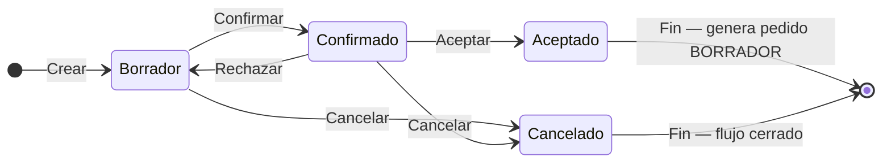

## Resumen

Los presupuestos permiten formalizar una propuesta comercial con precios definidos y condiciones claras.

Representan un nivel mayor de definición dentro del flujo de ventas, previo al compromiso operativo.

No impactan stock ni cuenta corriente hasta su aceptación.

---

## Antes de empezar

- Verificá que los productos tengan precios correctos.
- Definí el contacto.
- Algunas modificaciones pueden requerir permisos especiales.

---

## Ubicación dentro del flujo

Cotización → Presupuesto → Pedido → Venta

El presupuesto es la etapa donde se formaliza la propuesta.

👉 Al aceptar, se genera un pedido en BORRADOR.

---

## Cuándo usar presupuestos

Usá presupuestos cuando:

- El cliente ya tiene una propuesta definida.
- Querés fijar precios por un período.
- Estás esperando confirmación final.
- Necesitás formalizar una cotización.

---

## Qué cambia y qué no cambia

**El presupuesto:**

- ✔️ Define precios y condiciones
- ✔️ Permite avanzar a pedido
- ❌ No impacta stock
- ❌ No genera deuda

👉 El impacto ocurre al generar la venta.

---

## Procedimiento

1. Creá un presupuesto (formulario **V2**: [Formulario de documento V2](../guias/formulario-documento-v2.md)).
2. Seleccioná el contacto.
3. Completá **Presupuesto**, **Días vto** y, si corresponde, activá **Plantilla** / **Nombre de Plantilla** y **Enviar comprobante**.
4. Agregá ítems (**Agregar Items** o **Listado F4**): lista, precio, cantidad, descuento, impuesto.
5. Revisá totales (Subtotal · Descuento · Recargo · Envío · TOTAL).
6. Guardá con **Guardar (F2)** o **Guardar y Nuevo**. Atajos **/** y **\*** funcionan con accesos rápidos activos.
7. Confirmá el presupuesto en el listado.
8. Si el cliente acepta:
   - Se genera un pedido en **Borrador**

---

## Estados

| Estado | Descripción |
|--------|-------------|
| **Borrador** | Editable. |
| **Confirmado** | No editable. Espera respuesta. |
| **Aceptado** | Genera pedido en Borrador. |
| **Cancelado** | Flujo cerrado. |

**Rechazar** vuelve a **Borrador**.

### Ciclo de vida

**Estado inicial:** Borrador · **Estado final (éxito):** Aceptado · **Al rechazar:** vuelve a **Borrador** · **Cierre sin éxito:** Cancelado.

---

## Casos frecuentes

### El cliente evalúa una propuesta final
Se define precio y condiciones.

### Conversión desde cotización
Se selecciona la lista y se formaliza.

---

## Recomendaciones de uso

Los presupuestos son ideales cuando la negociación ya terminó y solo falta confirmación.

Usalos cuando:

- El precio ya está definido
- Querés formalizar condiciones
- El cliente necesita aprobación interna

👉 Evitá usarlos para comparación (eso corresponde a cotización).

---

## Si algo sale mal

- **No podés aceptar el presupuesto**
  - Puede estar **vencido** (revisá días de vencimiento en [Preferencias](../configuracion/preferencias.md)).
  - Verificá que esté en estado **Confirmado** y con ítems cargados.
- **No se genera el pedido**
  - El presupuesto debe quedar en **Aceptado**.
  - Revisá permisos de pedidos en [Perfiles](../administracion/perfiles.md).

---

## Buenas prácticas

- Controlá vigencia.
- Usá observaciones.
- Confirmá antes de enviar.

---

## Ver también

- [Formulario de documento V2](../guias/formulario-documento-v2.md)
- [Cotizaciones](./cotizaciones.md)
- [Pedidos](./pedidos.md)
- [Flujo de ventas](./flujo-ventas.md)
