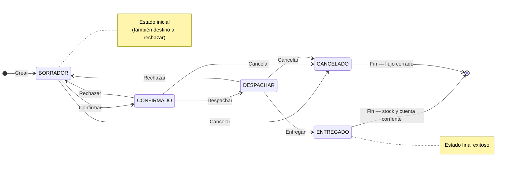

## Resumen

La venta es la etapa final del flujo comercial en ZinK ERP.

Representa el cierre de la operación y es el momento en el que el sistema impacta stock y cuenta corriente según el estado.

Puede generarse desde un pedido o registrarse directamente, según el tipo de operación.

También podés encontrar este proceso como **venta comercial**, **venta directa**, **venta con cuenta corriente**, **venta con cobro inmediato** o **cobro de venta**.

---

## Antes de empezar

- Definí correctamente el tipo de cliente:
  - Consumidor Final (pago inmediato)
  - Contacto (puede generar cuenta corriente)
- Verificá que los productos tengan precios válidos.
- Para registrar cobros en ventas comerciales, el usuario debe tener permiso para **realizar cobro en ventas**.
- Algunas modificaciones (precios, fechas, descuentos) pueden requerir permisos especiales.
- Revisá la configuración de **Proceso de Pago** en preferencias:
  - **Inmediato**: al confirmar la venta se abre el flujo de cobro.
  - **Diferido**: la venta puede quedar como deuda del contacto para cobrarse luego.

---

## Cuándo usar ventas

Usá esta pantalla cuando:

- necesitás cerrar una operación comercial con trazabilidad;
- el cliente puede generar cuenta corriente;
- querés registrar una venta directa fuera de POS;
- necesitás pasar por estados como confirmación, despacho o entrega.

---

## Ubicación dentro del flujo

La venta es la última etapa del proceso:

Cotización → Presupuesto → Pedido → **Venta**

- Puede generarse automáticamente desde un pedido en estado PREPARADO.
- También puede crearse directamente sin pasar por etapas anteriores.

---

## Qué cambia y qué no cambia

**La venta:**

- ✔️ Descarga stock (al marcar ENTREGADO)
- ✔️ Impacta cuenta corriente (según cliente)
- ✔️ Puede generar comprobante
- ❌ No es editable una vez confirmada (según estado)

---

## Procedimiento

### Paso 1: Crear la venta

1. Creá una nueva venta o generala desde un pedido.
2. Seleccioná el contacto.

### Paso 2: Definir el contexto comercial

3. Si es **Consumidor Final**, normalmente el circuito espera cobro inmediato.
4. Si es un contacto, la venta puede quedar con deuda según configuración.

### Paso 3: Cargar productos

5. Agregá productos y cantidades.
6. Ajustá precios o descuentos si corresponde y tenés permisos.

### Paso 4: Confirmar

7. Confirmá la venta.
8. Si aplica, registrá el cobro.

### Paso 5: Entregar

9. Gestioná despacho si tu operación lo requiere.
10. Marcá la venta como **ENTREGADO** para descontar stock e impactar cuenta corriente.

---

## Cobro de la venta

El cobro depende de tres factores:

| Factor | Qué define |
|--------|------------|
| Cliente | Si es **Consumidor Final**, normalmente se espera pago inmediato. Si es un contacto, puede usarse cuenta corriente según configuración. |
| Proceso de Pago | Define si la venta abre el cobro al confirmar o si permite cobrar más tarde. |
| Permisos | Para abrir y guardar el cobro, el usuario necesita permiso para **realizar cobro en ventas**. |

Cuando el cobro se registra correctamente, el sistema puede abrir el comprobante o continuar con el circuito fiscal según la configuración de la organización.

Si el usuario confirma una venta con contacto y el proceso de pago es diferido, la deuda queda asociada a la cuenta corriente del contacto y puede cobrarse luego desde Finanzas, Cuenta corriente o Pagos.

### Cuándo usar pago inmediato y cuándo diferido

- **Inmediato**: mostrador, retiro en el momento o venta que no debe quedar pendiente.
- **Diferido**: clientes con cuenta corriente, crédito comercial o cobranza posterior.

---

## Estados

| Estado     | Descripción |
|------------|------------|
| BORRADOR   | Editable. Permite modificar productos y datos. |
| CONFIRMADO | No editable. Permite avanzar al despacho. |
| DESPACHAR  | Control del inventario según configuración. |
| ENTREGADO  | Se descuenta stock y se impacta cuenta corriente. |
| RECHAZAR   | Vuelve a BORRADOR (no disponible en estados finales). |
| CANCELADO  | Flujo cerrado. No editable. |

### Ciclo de vida

**Estado inicial:** BORRADOR · **Estado final (éxito):** ENTREGADO · **Al rechazar:** vuelve a **BORRADOR** (no disponible desde ENTREGADO ni CANCELADO) · **Cierre sin éxito:** CANCELADO.

---

## Casos frecuentes

### Venta desde pedido

El sistema genera automáticamente la venta al completar un pedido.

### Venta directa

Se crea una venta sin pasar por cotización, presupuesto o pedido.

### Venta en mostrador

Se registra con pago inmediato y puede marcarse directamente como ENTREGADO.

El cobro en este tipo de venta depende del permiso para **realizar cobro en ventas**.

### Venta con contacto y pago diferido

Se confirma la venta y el saldo queda pendiente en la cuenta corriente del cliente.

Usá este caso cuando el cliente compra a crédito, tiene condiciones comerciales o se acuerda cobrar luego.

### Venta con contacto y pago inmediato

Se confirma la venta y se abre el formulario de cobro.

Usá este caso cuando querés mantener el historial del cliente pero cobrar en el momento.

### Venta con stock comprometido

Si trabajás con control operativo o despacho, no des por cerrada la operación hasta validar la entrega y el impacto final en stock.

---

## Si algo sale mal

- **No se abre el formulario de cobro**
  - Revisá si el proceso de pago está configurado como inmediato o diferido.
  - Si debería cobrarse en el momento, revisá el permiso para realizar cobro en ventas.
  - Verificá que la venta haya sido confirmada correctamente.

- **El formulario de cobro aparece, pero no permite guardar**
  - Revisá que haya un medio de pago cargado.
  - Verificá que la suma de medios de pago coincida con el total.
  - Si usás Mercado Pago, el pago debe estar aprobado antes de guardar.

- **No podés marcar como ENTREGADO**
  - Verificá que el pago esté cargado (Consumidor Final).
  - Si no podés registrar el cobro, revisá el permiso para realizar cobro en ventas.

- **No podés modificar la venta**
  - Puede estar en un estado no editable.

- **Problemas con precios**
  - Revisá [listas de precio](../configuracion/listas-precio.md) o permisos.

---

## Buenas prácticas

- Verificá el cliente antes de confirmar.
- Controlá precios y descuentos.
- Para ventas en mostrador, cargá el pago antes de finalizar.
- Usá el flujo de despacho si trabajás con logística.

---

## Preguntas frecuentes

### ¿Qué diferencia hay entre POS y ventas?

POS es para operación rápida en mostrador. Ventas sirve mejor para circuitos con más control, cuenta corriente, etapas o despacho.

### ¿Cuándo impacta el stock?

Según el flujo documentado, al marcar la venta como **ENTREGADO**.

### ¿Puedo cobrar después?

Sí, si la configuración y el tipo de cliente permiten proceso de pago diferido.

---

## Ver también

- [Pedidos](./pedidos.md)
- [POS](./pos.md)
- [Consulta de precios](./consulta-precio.md)
- [Notas de crédito](./notas-credito.md)
- [Notas de débito](./notas-debito.md)
- [Flujo de ventas](./flujo-ventas.md)
- [Pagos](../finanzas/pagos.md)
- [Perfiles](../administracion/perfiles.md)
