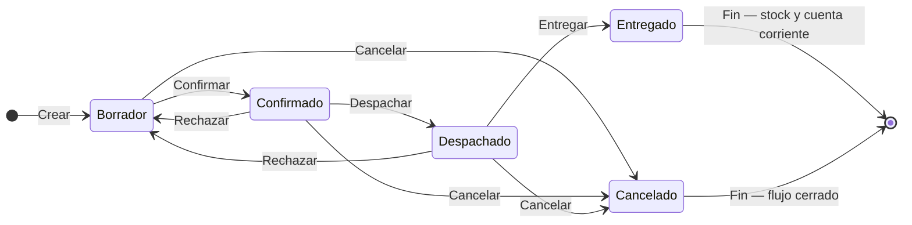

## Resumen

La venta es la etapa final del flujo comercial en Zink ERP.

Representa el cierre de la operación y es el momento en el que el sistema impacta stock y cuenta corriente según el estado.

Puede generarse desde un pedido o registrarse directamente, según el tipo de operación.

También podés encontrar este proceso como **venta comercial**, **venta directa**, **venta con cuenta corriente**, **venta con cobro inmediato** o **cobro de venta**.

---

## Antes de empezar

- Definí correctamente el tipo de cliente:
  - Consumidor Final (pago inmediato)
  - Contacto (puede generar cuenta corriente)
- Verificá que los productos tengan precios válidos.
- Para registrar cobros en ventas comerciales, el usuario debe tener permiso para **realizar cobro en ventas**.
- Algunas modificaciones (precios, fechas, descuentos) pueden requerir permisos especiales.
- Revisá la configuración de **Proceso de Pago** en preferencias:
  - **Inmediato**: al confirmar la venta se abre el flujo de cobro.
  - **Diferido**: la venta puede quedar como deuda del contacto para cobrarse luego.

---

## Cuándo usar ventas

Usá esta pantalla cuando:

- necesitás cerrar una operación comercial con trazabilidad;
- el cliente puede generar cuenta corriente;
- querés registrar una venta directa fuera de POS;
- necesitás pasar por estados como confirmación, despacho o entrega.

---

## Ubicación dentro del flujo

La venta es la última etapa del proceso:

Cotización → Presupuesto → Pedido → **Venta**

- Puede generarse automáticamente desde un pedido en estado Preparado.
- También puede crearse directamente sin pasar por etapas anteriores.

---

## Qué cambia y qué no cambia

**La venta:**

- ✔️ Descarga stock (al marcar Entregado)
- ✔️ Impacta cuenta corriente (según cliente)
- ✔️ Puede generar comprobante
- ❌ No es editable una vez confirmada (según estado)

---

## Procedimiento

### Paso 1: Crear la venta

1. Creá una nueva venta o generala desde un pedido.
2. Seleccioná el contacto.

### Paso 2: Definir el contexto comercial

3. Si es **Consumidor Final**, normalmente el circuito espera cobro inmediato.
4. Si es un contacto, la venta puede quedar con deuda según configuración.

### Paso 3: Cargar productos

5. Agregá productos y cantidades en el formulario ([Formulario de documentos](../guias/formulario-documento-v2.md)). Labels compactos: **Venta**, **Entrega**, **Días cobro** (con `Vence:`). Si viene de un pedido, verás **Pedido origen: …**.
6. Ajustá precios, descuentos, recargos o envío si corresponde y tenés permisos.

### Paso 4: Confirmar

7. Guardá la venta con **Guardar (F2)**. En el diálogo **GUARDAR VENTA**, **Enter** confirma y **Esc** cancela.
8. Si aplica, registrá el cobro. Completá el cobro o abandoná desde el diálogo de pago antes de volver a guardar.
9. Tras el cobro puede aparecer **Venta registrada** con **Imprimir**, **Fiscal (F10)** y **Nueva venta**.

### Paso 5: Entregar

10. Si tu operación lo requiere, usá **Despachar** (estado **Despachado**).
11. Marcá la venta como **Entregado** para descontar stock e impactar cuenta corriente.

---

## Atajos del formulario de venta

| Tecla | Acción |
|-------|--------|
| **F2** | Guardar la venta (también en el botón). No uses Enter para guardar el form (evita doble envío con red lenta). |
| **F4** | Listado de productos. En cobro post-venta: calculadora de vuelto. |
| **Enter** | Confirma el diálogo de guardado; en ítems avanza entre campos. |
| **Esc** | Cancela el diálogo. |
| **/** y **\*** | Con accesos rápidos: precio / cantidad del ítem anterior. |
| **↓** | Con accesos rápidos: siguiente producto. |
| **-** (en campo producto) | Focus en descuento del ítem. |

En el cobro post-venta, **F2** guarda el pago y **F4** abre la calculadora de vuelto en efectivo. Detalle en [Pagos](../finanzas/pagos.md).

---

## Cobro de la venta

El cobro depende de tres factores:

| Factor | Qué define |
|--------|------------|
| Cliente | Si es **Consumidor Final**, normalmente se espera pago inmediato. Si es un contacto, puede usarse cuenta corriente según configuración. |
| Proceso de Pago | Define si la venta abre el cobro al confirmar o si permite cobrar más tarde. |
| Permisos | Para abrir y guardar el cobro, el usuario necesita permiso para **realizar cobro en ventas**. |

Cuando el cobro se registra correctamente, el sistema puede abrir el comprobante o continuar con el circuito fiscal según la configuración de la organización.

Desde la **consulta del comprobante** (abrí la venta por el número o el menú del listado) podés:

- **Enviar por correo** el PDF al email del contacto (nativo y fiscal en el mismo mensaje, si hay documento fiscal). Si ya se envió, la acción pasa a **Enviar nuevamente**.
- En vista **Fiscal** con facturación **ARCA**, elegir formato **Ticket** o **A4** (diseño propio de Zink ERP).

Si el usuario confirma una venta con contacto y el proceso de pago es diferido, la deuda queda asociada a la cuenta corriente del contacto y puede cobrarse luego desde Finanzas, Cuenta corriente o Pagos.

### Cuándo usar pago inmediato y cuándo diferido

- **Inmediato**: mostrador, retiro en el momento o venta que no debe quedar pendiente.
- **Diferido**: clientes con cuenta corriente, crédito comercial o cobranza posterior.

---

## Estados

| Estado | Descripción |
|--------|-------------|
| **Borrador** | Editable. |
| **Confirmado** | Permite avanzar al despacho. |
| **Despachado** | Control de mercadería (acción **Despachar**). |
| **Entregado** | Descuenta stock e impacta cuenta corriente. |
| **Cancelado** | Flujo cerrado. |

**Rechazar** vuelve a **Borrador** (no disponible en estados finales).

### Ciclo de vida

**Estado inicial:** Borrador · **Estado final (éxito):** Entregado · **Al rechazar:** vuelve a **Borrador** · **Cierre sin éxito:** Cancelado.

---

## Casos frecuentes

### Venta desde pedido

El sistema genera automáticamente la venta al completar un pedido.

### Venta directa

Se crea una venta sin pasar por cotización, presupuesto o pedido.

### Venta en mostrador

Se registra con pago inmediato y puede marcarse directamente como Entregado.

El cobro en este tipo de venta depende del permiso para **realizar cobro en ventas**.

### Venta con contacto y pago diferido

Se confirma la venta y el saldo queda pendiente en la cuenta corriente del cliente.

Usá este caso cuando el cliente compra a crédito, tiene condiciones comerciales o se acuerda cobrar luego.

### Venta con contacto y pago inmediato

Se confirma la venta y se abre el formulario de cobro.

Usá este caso cuando querés mantener el historial del cliente pero cobrar en el momento.

### Venta con stock comprometido

Si trabajás con control operativo o despacho, no des por cerrada la operación hasta validar la entrega y el impacto final en stock.

---

## Listado y preferencias

En el listado de ventas podés buscar desde la grilla o abrir el **filtro avanzado** (fechas, montos, estado, contacto). El intervalo de fechas no puede superar **tres meses**.

En computadora, el menú **Columnas** permite mostrar u ocultar columnas. Al final de ese menú podés marcar **“Recordar preferencias de este listado”** (también como **“Recordar filtro”** en el filtro avanzado; ambas opciones comparten el mismo estado).

Si la opción está activa, el sistema guarda en **este navegador** —por usuario y sucursal—:

- el último filtro avanzado aplicado;
- qué columnas elegiste ver u ocultar;
- cuántas **filas por página** (50, 100 o 150).

No guarda anchos de columnas, orden de columnas, número de página, ordenamiento ni la búsqueda rápida de la barra. Si desmarcás la opción, deja de restaurar y se borra lo guardado para esa sucursal y pantalla.

Desde el detalle de una venta, el listado de pagos muestra medio de pago (con datos de cheque o transferencia), hora, observación e importe **imputado a esa venta**.

---

## Duplicar y compartir

- **Duplicar**: desde **Más acciones** en el listado o con el botón **Duplicar** en el detalle, abrís una venta nueva con el mismo contacto, productos y cantidades. Ver [Duplicar documentos](../guias/duplicar-documentos.md).
- **Duplicar como pedido o presupuesto**: en el listado, tocá el **+** junto a **Duplicar** en **Más acciones**; en el detalle, tocá **Duplicar** y elegí el destino. Los precios se calculan a hoy y, si algún producto ya no está disponible, el aviso lo nombra. Ver [Duplicar una venta como pedido o presupuesto](../guias/duplicar-documentos.md#duplicar-una-venta-como-pedido-o-presupuesto).
- **Compartir**: desde el detalle podés copiar un resumen, mandarlo por WhatsApp o email, o descargar el PDF. Ver [Compartir y enviar documentos](../guias/compartir-y-enviar-documentos.md).
- **Comprobantes**: en **Más acciones** del listado, **Comprobantes** abre el comprobante de la venta y, si tiene, el fiscal, en el mismo visor.
- **Enviar por correo**: desde el comprobante (**Comprobantes** en el listado o **Ver comprobante** en el detalle), el ícono de sobre manda el comprobante al email del cliente. Ver [Compartir y enviar documentos](../guias/compartir-y-enviar-documentos.md#enviar-por-correo).

---

## Si algo sale mal

- **No se abre el formulario de cobro**
  - Revisá si el proceso de pago está configurado como inmediato o diferido.
  - Si debería cobrarse en el momento, revisá el permiso para realizar cobro en ventas.
  - Verificá que la venta haya sido confirmada correctamente.

- **El formulario de cobro aparece, pero no permite guardar**
  - Revisá que haya un medio de pago cargado.
  - Verificá que la suma de medios de pago coincida con el total.
  - Si usás Mercado Pago, el pago debe estar aprobado antes de guardar.

- **No podés marcar como Entregado**
  - Verificá que el pago esté cargado (Consumidor Final).
  - Si no podés registrar el cobro, revisá el permiso para realizar cobro en ventas.

- **No podés modificar la venta**
  - Puede estar en un estado no editable.

- **Problemas con precios**
  - Revisá [listas de precio](../configuracion/listas-precio.md) o permisos.

---

## Buenas prácticas

- Verificá el cliente antes de confirmar.
- Controlá precios y descuentos.
- Para ventas en mostrador, cargá el pago antes de finalizar.
- Usá el flujo de despacho si trabajás con logística.

---

## Preguntas frecuentes

### ¿Qué diferencia hay entre POS y ventas?

POS es para operación rápida en mostrador. Ventas sirve mejor para circuitos con más control, cuenta corriente, etapas o despacho.

### ¿Cuándo impacta el stock?

Al marcar la venta como **Entregado**.

### ¿Puedo cobrar después?

Sí, si la configuración y el tipo de cliente permiten proceso de pago diferido.

---

## Ver también

- [Formulario de documentos](../guias/formulario-documento-v2.md)
- [Pedidos](./pedidos.md)
- [POS](./pos.md)
- [Consulta de precios](./consulta-precio.md)
- [Notas de crédito](./notas-credito.md)
- [Notas de débito](./notas-debito.md)
- [Flujo de ventas](./flujo-ventas.md)
- [Cuenta corriente](../finanzas/cuenta-corriente.md)
- [Pagos](../finanzas/pagos.md)
- [Perfiles](../administracion/perfiles.md)
- [Duplicar documentos](../guias/duplicar-documentos.md)
- [Compartir y enviar documentos](../guias/compartir-y-enviar-documentos.md)
